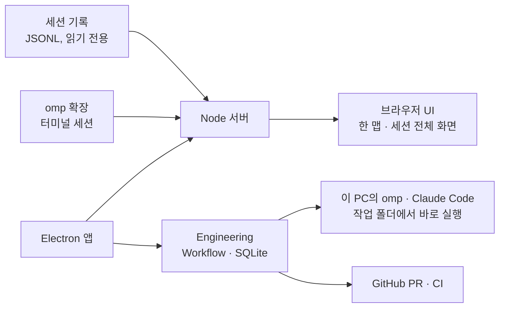

# OMP Live Map

> OMP와 Claude Code 에이전트를 지도 한 장에서 관제하고, 같은 앱에서 개발 업무를 Workflow로 맡기는 Windows 로컬 워크스테이션입니다.

[](https://github.com/thdrmsqhd/omp-live-map/actions/workflows/v2-phase-0.yml)

[주요 화면](#주요-화면) · [시작하기](#시작하기) · [Engineering](docs/guide/engineering.md) · [문서](#문서) · [최신 릴리스](https://github.com/thdrmsqhd/omp-live-map/releases/latest)

## 한눈에 보기

| | 관제 (Live Map) | Engineering |
|---|---|---|
| **역할** | 이 PC에서 도는 세션·서브에이전트의 상태, 토큰·비용·컨텍스트, 프로세스 자원을 실시간으로 보고 프롬프트 전송·셸 명령·프로세스 정리를 합니다. | 모델 → 하네스 → 루프 → Workflow → 개발 Task로 업무를 정의하고, 승인·개입 지점을 두고 에이전트에게 실행시킵니다. |
| **대상** | omp 세션, Claude Code 세션 | omp, Claude Code (이 PC에서 고른 작업 폴더에 바로 실행) |
| **사용처** | 웹 모드와 데스크톱 앱 (같은 한 맵) | 웹 모드와 데스크톱 앱 (같은 한 맵의 Task 줄·서랍) |
| **데이터** | 세션 기록(JSONL)을 읽기만 함. 서버가 상태를 따로 저장하지 않음 | SQLite(데스크톱은 앱 사용자 데이터 폴더, 웹 모드는 `data/engineering/`). 버전·실행·승인·감사 이벤트 |

- **한 맵에 세션·Task·Workflow**: 프로젝트 띠 안에 Task 줄, 그 오른쪽에 Workflow 단계(하네스·루프 칩), 단계 아래에 그 단계에서 실제로 돈 omp·claude 세션 카드가 선으로 이어집니다. Task 없이 연 세션은 프로젝트 띠 안에 폴더별로 놓입니다. 기본은 자동 배치이고, 끌어 옮긴 카드만 그 자리를 기억합니다.
- **업무를 Workflow로**: 계획 → 설계 승인 → 작업 및 검증 → 리뷰 → 최종 승인 같은 흐름을 그래프로 그리고 버전으로 고정합니다. 과거 실행은 시작한 버전을 유지합니다.
- **사람이 개입하는 지점이 분명**: 승인 대기, 실패한 검증, 확인이 필요한 실행이 **개입 필요**에 모이고, 재검증·구현 보완 요청·승인·반려를 그 자리에서 처리합니다.
- **이 PC에서 바로 실행**: 에이전트는 이 PC에 설치된 omp·claude CLI로, 고른 작업 폴더에서 내 계정 권한으로 돕니다(터미널에서 직접 실행하는 것과 같습니다). 시간·예산 한도와 승인 단계가 있고, 결과가 불확실한 단계는 다시 실행하지 않습니다.
- **가볍게 로컬로**: 웹 모드는 Node 내장 모듈만 쓰고 `127.0.0.1`에만 바인드합니다. 로그인이 없는 1인 로컬 사용을 전제로 합니다.

## 주요 화면

아래 화면은 실제 앱을 데모 데이터로 실행해 캡처했습니다. 세션과 프로젝트는 가상의 예시이고, 자원 수치는 캡처한 PC의 값입니다.

### 한 맵

탭은 없습니다. 화면은 **한 맵**과, 세션 하나를 크게 여는 **전체 화면** 두 가지입니다.

- **프로젝트 띠**: 머리 한 줄에 세션 수·토큰·비용·주의 필요·CPU/RAM, 두 번째 줄에 `최근 7일 실행 12건 · $34.00 / 예산 $100.00`과 상태별 Task 수, **＋ Task**가 있습니다. 띠는 접고 순서를 바꿀 수 있습니다(저장).
- **Task 줄**: 상태 색(Backlog·준비·진행 중·승인 대기·보류·완료)으로 칸반 칸을 대신하고, 개입 필요 → 진행 중 → 대기 → 완료 순서로 놓입니다. Backlog의 단계는 흐리게, 완료 Task는 결과 요약 한 줄로 접힙니다. ▶로 실행합니다.
- **Workflow 단계**: 단계마다 하네스·루프 칩이 붙고, 승인 대기 단계에는 **승인·반려** 버튼이 바로 있습니다. 단계·칩을 누르면 오른쪽 서랍에서 역할·지시·모델·재시도·한도·검증 명령을 고치고 자동 저장합니다. 저장 범위는 **이 Task만**(기본, Task 전용 사본) 또는 **템플릿**(새 버전)입니다.
- **Workflow 편집**: Task ⋯ > Workflow 편집에서 단계 사이 **＋**로 넣고, 끌어서 순서를 바꾸고, 단계 ⋯로 지웁니다.
- **세션 카드**: 단계 아래에 실제 세션(재시도 포함)이 이어지고, 끝난 세션은 칩으로 줄어듭니다(누르면 펼침). 두 번 누르거나 **열기**를 누르면 대화·터미널·파일이 있는 전체 화면이 열리고, <kbd>Esc</kbd>·**← 맵으로**는 같은 맵 위치로 돌아갑니다.
- **위쪽 막대**: **＋ 새 실행**(지금 프로젝트의 ＋ Task 줄, Enter = 만들고 실행), `● omp · claude` 실행 환경 점, **개입 필요 N**(기다리는 단계로 이동), 자원 한 줄 `CPU 45% · RAM 80% · WSL ● · Docker ○`(누르면 HOST·WSL·Docker 서랍, 기존 인프라 동작 그대로).
- **라이브러리**(맵 왼쪽 위): 하네스·루프·모델·Workflow 템플릿 목록과 새로 만들기·복제·삭제.

자세한 사용법은 [관제와 한 맵 사용법](docs/guide/live-map.md)과 [Engineering 가이드](docs/guide/engineering.md)에 있습니다. 아래 `docs/media/v8` 스크린샷은 한 맵 이전 화면이며 다시 찍어야 합니다.

## 시작하기

관제와 Engineering은 **한 맵**입니다. 탭 없이 맵과 세션 전체 화면만 오가며, 웹 모드와 데스크톱 앱이 똑같이 동작합니다.

### Windows 데스크톱 앱

1. [Releases](https://github.com/thdrmsqhd/omp-live-map/releases/latest)에서 `OMP-Live-Map-<버전>-Windows-x64-Setup.exe`를 받고, 같은 릴리스의 `SHA256SUMS.txt`로 체크섬을 확인합니다. 설치 파일에는 코드 서명이 없습니다.
2. 설치 후 실행하면 앱이 로컬 서버를 빈 포트로 띄우고 웹 모드와 같은 화면을 창으로 엽니다. 작업 폴더를 고를 때 폴더 선택 대화상자를 쓸 수 있는 것만 다릅니다. 7800 포트의 기존 서비스는 건드리지 않고, 앱은 하나만 실행됩니다.
3. Engineering을 쓰려면 이 PC에 `omp` 또는 `claude` CLI가 설치·로그인돼 있어야 합니다. 처음 쓰는 순서는 [Engineering 가이드](docs/guide/engineering.md#처음-쓰기)를 보세요.

### 웹 모드

```bash
node server.js --port 7800 --hours 24
# http://127.0.0.1:7800
```

웹 모드에서도 Task·Workflow 편집과 실행을 모두 씁니다. 세션이 열린 폴더는 맵에 폴더 띠로 나오고, 그 띠의 **＋ Task**가 폴더를 프로젝트로 만듭니다. 서버는 `127.0.0.1`에만 열리고, `Host`가 `127.0.0.1:<포트>`·`localhost:<포트>`가 아닌 요청(DNS rebinding)과 다른 출처의 상태 변경 요청은 거부합니다. `/api/engineering/*`와 운영 API는 서버를 시작할 때마다 새로 만드는 토큰이 있어야 하며, 이 토큰은 같은 출처 화면(`/`)에만 심겨 갑니다. 예전 주소 `/engineering.html`은 한 맵(`/`)으로 넘어갑니다.

### 준비물

| 항목 | 필요한 경우 |
|---|---|
| Node.js 22 이상 | 웹 모드. 컨텍스트 상한 조회에 `node:sqlite`를 씁니다(없으면 사용률만 빠집니다). 데스크톱 앱에는 포함됩니다. |
| Git Bash | 카드의 터미널과 백그라운드 잡. 기본 경로 `C:\Program Files\Git\bin\bash.exe` |
| `omp` 또는 `claude` CLI(PATH) | 맵에서 세션을 만들거나 이어갈 때. 둘 다 없어도 기록 읽기와 지도 보기는 됩니다. |
| omp 또는 Claude Code CLI (`claude`) | Engineering 실행. 고른 작업 폴더에서 바로 띄우며, 로그인·모델 설정은 각 CLI의 것을 씁니다. |

### 설정

| 옵션·환경변수 | 기본값 | 내용 |
|---|---|---|
| `--port` | 7800 | 서버 포트 |
| `--hours` | 24 | 스냅샷에 넣을 세션의 최근 활동 범위(시간) |
| `OMP_MAP_BASH` | `C:\Program Files\Git\bin\bash.exe` | 터미널·백그라운드 잡에 쓰는 bash |
| `OMP_MAP_CWD` | 프로젝트 폴더의 부모 | 새 로컬 카드의 기본 폴더 |
| `OMP_MAP_STATE` | 프로젝트의 `data/` | Claude 카드별 모델 선택과 비우기 계보를 저장하는 폴더 |
| `OMP_MAP_SESSIONS` | `~/.omp/agent/sessions` | 읽을 omp 세션 기록 폴더(검증·데모용으로 바꿀 수 있음) |
| `OMP_MAP_CLAUDE_PROJECTS` | `~/.claude/projects` | 읽을 Claude Code 세션 기록 폴더 |
| `OMP_MAP_CLAUDE_MODEL` | `default` | Claude Code 카드에서 "CLI 기본 모델"로 넘길 `--model` 값 |
| `OMP_MAP_CLAUDE_MAX_RUNS` | 4 | 동시에 실행할 Claude Code 프로세스 수(1~32) |
| `OMP_USD_KRW` | 1390 | 비용 원화 환산 환율 |
| `OMP_LLM_BASE_URL`, `OMP_LLM_API_KEY`, `OMP_LLM_MODEL` | `~/.omp/agent/models.yml`의 provider | 세션 요약(`/api/summary`)에 쓰는 OpenAI 호환 엔드포인트 |
| `OMP_SUMMARY_MODEL` | provider 기본 모델 | 요약 모델만 따로 지정 |
| `OMP_PYRIGHT` | PATH에서 탐색 | 코드 편집기의 Python 언어 서버(`pyright-langserver`) 경로 |

`ui/` 파일은 요청할 때마다 디스크에서 읽으므로 새로고침하면 반영됩니다. `server.js`와 `server/`를 고치면 서버를 다시 띄워야 합니다.

## 어떻게 동작하나



- 세션 상태의 원본은 JSONL 하나입니다. 서버를 다시 띄우면 기록에서 그대로 복원합니다([ADR-0002](docs/adr/0002-jsonl-single-source-no-server-state.md)).
- 맵이 직접 만든 omp 세션은 세션마다 상주하는 `omp --mode rpc-ui` 프로세스가 맡고([ADR-0001](docs/adr/0001-map-session-per-rpc-process.md)), Claude Code는 기록을 읽기 전용으로 그립니다.
- 화면은 번들러와 프레임워크 없이 계층(core → model → viewmodel → view)으로 나눈 Vanilla JS입니다. 자세한 구조는 [구조와 설계 규칙](docs/reference/architecture.md)을 보세요.

## 문서

| 문서 | 내용 |
|---|---|
| [Engineering 가이드](docs/guide/engineering.md) | 하네스·루프·Workflow·개발 Task·실행, 안전장치, 처음 쓰기 |
| [관제와 한 맵 사용법](docs/guide/live-map.md) | 한 맵(띠·Task·단계·세션), 세션 전체 화면, 블록, 단축키·마우스 조작, 코드 편집기 |
| [하네스: omp와 Claude Code](docs/guide/harness.md) | 하네스별 동작, 하네스 전환, 터미널 세션 실시간 표시 확장 |
| [API와 보안](docs/reference/api.md) | 관측·제어 API, 접근 방어 |
| [구조와 설계 규칙](docs/reference/architecture.md) | 디렉터리 구조, 계층 규칙 |
| [개발과 검증](docs/development.md) | 테스트, CI, 스크린샷 다시 만들기, 릴리스 |
| [용어집](docs/glossary.md) · [ADR](docs/adr) | 용어와 설계 결정 기록 |

## 보안

이 서버는 셸 명령 실행과 에이전트 프롬프트 전송을 받습니다. `127.0.0.1`에만 바인드하고, `Host`·`Origin`·`Sec-Fetch-Site`·`Content-Type`을 검사해 브라우저의 다른 사이트가 명령을 보낼 수 없게 막습니다. 이 PC에 로그인한 다른 프로그램은 막지 못하므로 포트를 외부에 열거나 프록시 뒤에 두지 마세요. 자세한 내용은 [API와 보안](docs/reference/api.md#보안)을 보세요.
