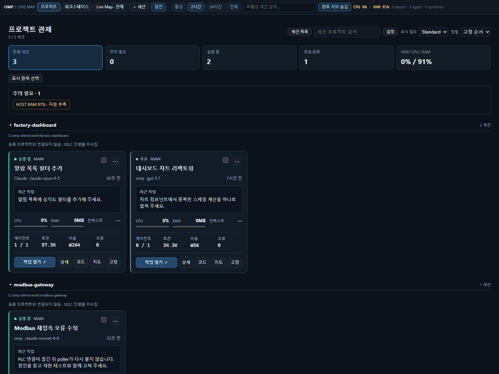
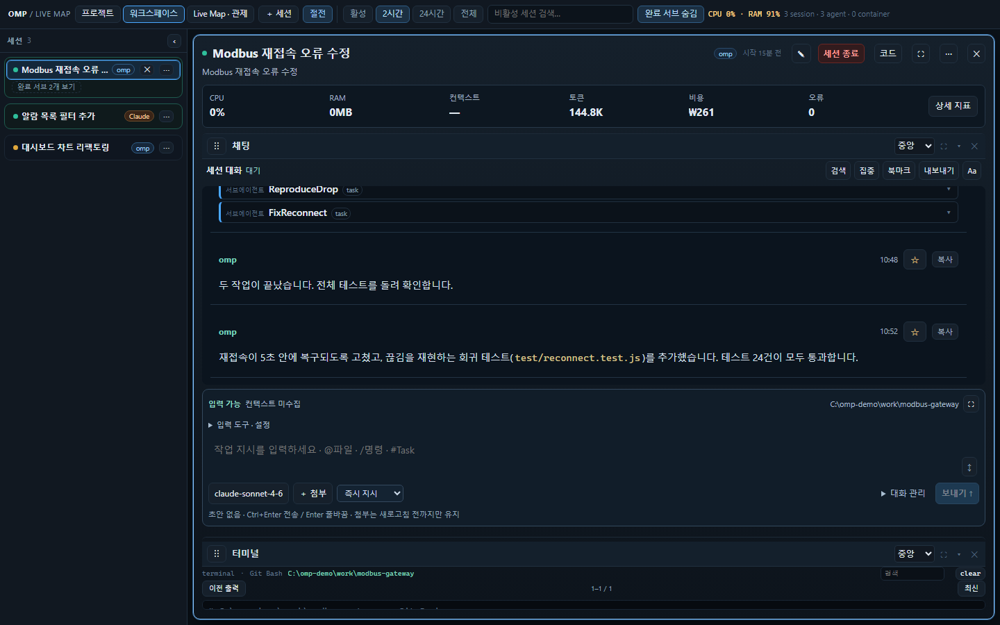
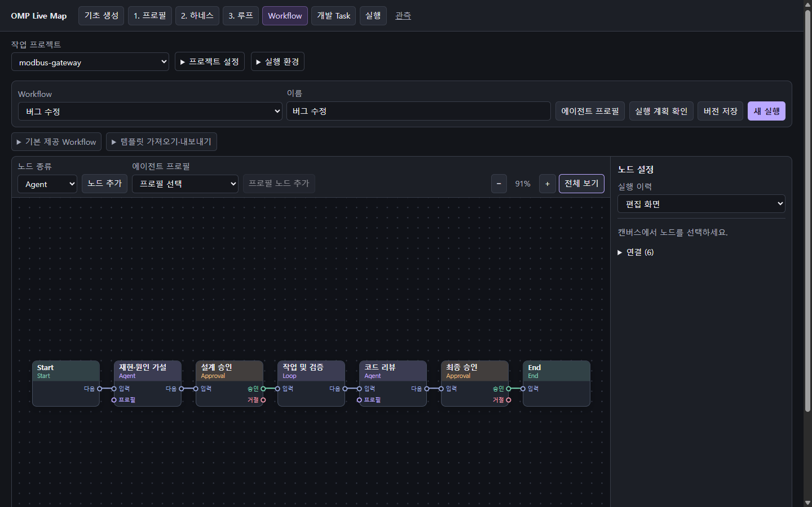
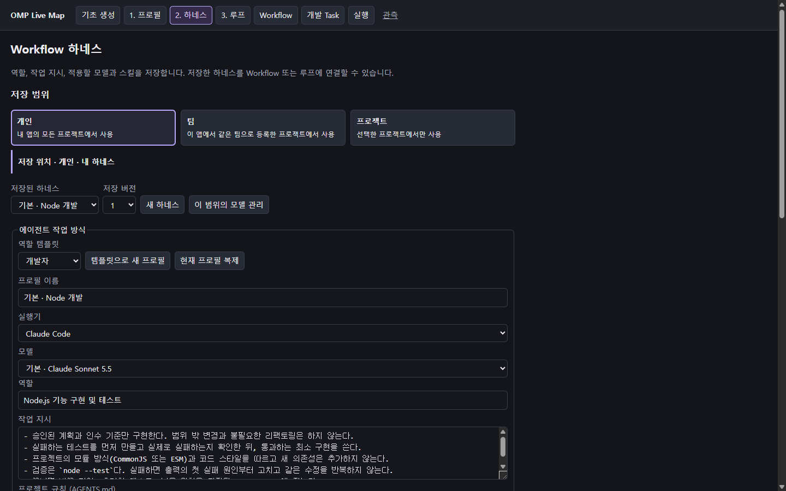
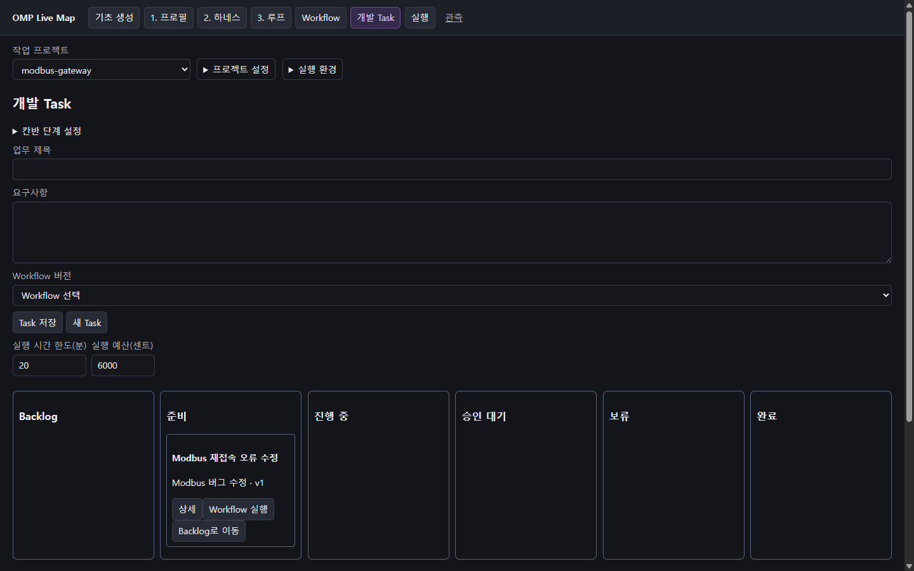
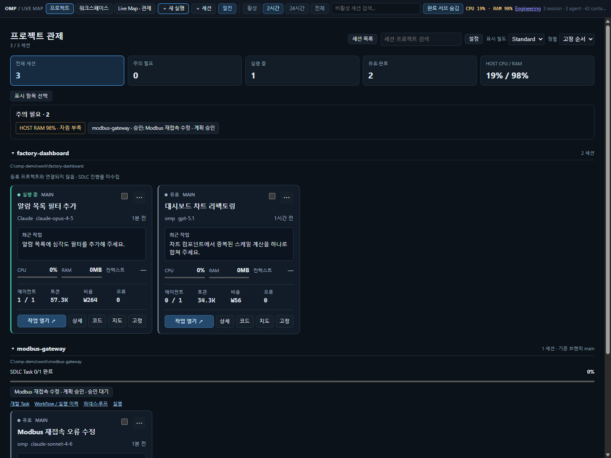
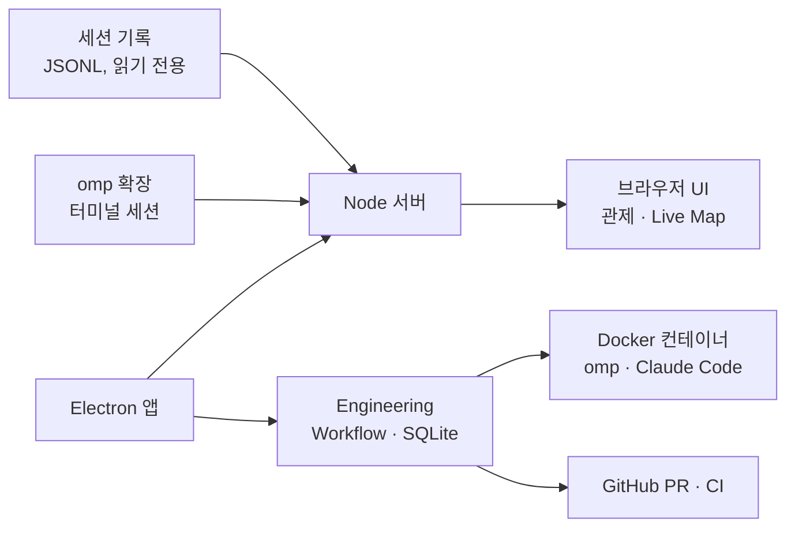

# OMP Live Map

> OMP와 Claude Code 에이전트를 지도 한 장에서 관제하고, 같은 앱에서 개발 업무를 Workflow로 맡기는 Windows 로컬 워크스테이션입니다.

[](https://github.com/thdrmsqhd/omp-live-map/actions/workflows/v2-phase-0.yml)

[주요 화면](#주요-화면) · [시작하기](#시작하기) · [Engineering](docs/guide/engineering.md) · [문서](#문서) · [최신 릴리스](https://github.com/thdrmsqhd/omp-live-map/releases/latest)

## 한눈에 보기

| | 관제 (Live Map) | Engineering |
|---|---|---|
| **역할** | 이 PC에서 도는 세션·서브에이전트의 상태, 토큰·비용·컨텍스트, 프로세스 자원을 실시간으로 보고 프롬프트 전송·셸 명령·프로세스 정리를 합니다. | 프로필 → 하네스 → 루프 → Workflow → 개발 Task로 업무를 정의하고, 승인·개입 지점을 두고 에이전트에게 실행시킵니다. |
| **대상** | omp 세션, Claude Code 세션 | omp, Claude Code (컨테이너에서 격리 실행) |
| **사용처** | 웹 모드와 데스크톱 앱 | 데스크톱 앱 |
| **데이터** | 세션 기록(JSONL)을 읽기만 함. 서버가 상태를 따로 저장하지 않음 | 앱 사용자 데이터 폴더의 SQLite. 버전·실행·승인·감사 이벤트 |

- **한 지도에 모든 세션**: 프로젝트별로 묶어 비교하고, 열어 둔 카드를 자유롭게 배치합니다. 실행 중인 서브에이전트는 메인 카드에 자동으로 붙었다가 끝나면 닫힙니다.
- **업무를 Workflow로**: 계획 → 설계 승인 → 작업 및 검증 → 리뷰 → 최종 승인 같은 흐름을 그래프로 그리고 버전으로 고정합니다. 과거 실행은 시작한 버전을 유지합니다.
- **사람이 개입하는 지점이 분명**: 승인 대기, 실패한 검증, 확인이 필요한 실행이 **개입 필요**에 모이고, 재검증·구현 보완 요청·승인·반려를 그 자리에서 처리합니다.
- **안전하게 실행**: 에이전트는 네트워크 없는 컨테이너와 별도 Git worktree에서 돌고, 시간·예산 한도가 있으며, 결과가 불확실한 단계는 다시 실행하지 않습니다.
- **가볍게 로컬로**: 웹 모드는 Node 내장 모듈만 쓰고 `127.0.0.1`에만 바인드합니다. 로그인이 없는 1인 로컬 사용을 전제로 합니다.

## 주요 화면

아래 화면은 실제 앱을 데모 데이터로 실행해 캡처했습니다. 세션과 프로젝트는 가상의 예시이고, 자원 수치는 캡처한 PC의 값입니다.

### 관제: 지금 무슨 일이 일어나는지



**프로젝트 관제.** 프로젝트별로 세션을 묶어 상태, 하네스(omp·Claude), 토큰·비용·컨텍스트, CPU·RAM을 한눈에 비교합니다. 표시 밀도(Compact·Standard·Detailed)와 정렬(고정 순서·주의 우선·메모리·최근 활동·이름)을 고르고, 주의가 필요한 항목은 **주의 필요**에 따로 모읍니다.



**워크스페이스.** 카드 하나에 집중해 대화, Git Bash 터미널, 세션 폴더의 파일을 한 화면에서 다룹니다. 서브에이전트의 작업은 대화 안에서 접어 볼 수 있고, Monaco 코드 편집기는 **코드** 버튼으로 필요할 때만 엽니다.


**Live Map.** 열어 둔 카드와 HOST·WSL·Docker 자원 카드를 한 캔버스에 배치합니다. 격자·가로·세로 정렬, 배치 저장·복원, Undo/Redo, 미니맵을 지원합니다.

### Engineering: 업무를 정의하고 맡기기


**노드 캔버스.** ComfyUI처럼 모델 → 하네스 → 루프 → Workflow 단계, 에이전트 프로필 → Agent를 색이 다른 소켓과 선으로 잇고, 노드 안의 셀렉트·입력칸으로 바로 고칩니다. 바뀐 노드는 한 번에 저장되고(<kbd>Ctrl</kbd>+<kbd>S</kbd>), 저장 형식은 기존 폼 화면과 같습니다. [사용법](docs/guide/engineering.md#노드-캔버스-기본-화면)



**Workflow 캔버스.** 기본 제공 8종(신규 기능, 버그 수정, 리팩토링, 코드 리뷰, 테스트 작성, 기술 문서, 릴리스, 장애 분석) 중 하나로 시작하거나 노드와 연결을 직접 그립니다. 위 화면은 **버그 수정** 템플릿입니다. 계획 → 설계 승인 → 작업 및 검증(Loop) → 코드 리뷰 → 최종 승인으로 이어집니다.



**하네스 편집.** 역할, 작업 지시, 모델, 읽을 자료, 스킬, 결과 형식을 정하고 개인·팀·프로젝트 범위로 저장합니다. 실제로 실행기에 전달될 값을 미리 보고, 기준 버전과 초안을 같은 입력으로 비교 실행할 수 있습니다.



**개발 Task.** Backlog · 준비 · 진행 중 · 승인 대기 · 보류 · 완료 칸반에서 업무를 관리합니다. Task마다 Workflow 버전과 시간·예산 한도를 고정해 실행하고, 승인 요청은 **승인 대기함**에 모입니다.

### 관제와 Engineering이 만나는 곳



**승인이 필요한 일을 놓치지 않기.** 등록한 프로젝트에는 SDLC Task 진행률과 승인 대기가 붙고, **주의 필요**에 `승인: Modbus 재접속 수정 · 계획 승인`처럼 바로 보입니다.


**같은 캔버스에서 승인·반려.** 실행 중인 Workflow가 세션 카드와 같은 Live Map에 노드와 연결선으로 나타납니다. 노드를 눌러 결과와 산출물을 확인하고, 메모와 함께 승인하거나 반려합니다.

## 시작하기

### Windows 데스크톱 앱 (Engineering 포함)

1. [Releases](https://github.com/thdrmsqhd/omp-live-map/releases/latest)에서 `OMP-Live-Map-<버전>-Windows-x64-Setup.exe`를 받고, 같은 릴리스의 `SHA256SUMS.txt`로 체크섬을 확인합니다. 설치 파일에는 코드 서명이 없습니다.
2. 설치 후 실행하면 앱이 로컬 서버를 빈 포트로 띄우고 같은 창에서 관제와 Engineering을 엽니다. 7800 포트의 기존 서비스는 건드리지 않고, 앱은 하나만 실행됩니다.
3. Engineering을 쓰려면 Docker Desktop(Linux 엔진)이 필요합니다. 처음 쓰는 순서는 [Engineering 가이드](docs/guide/engineering.md#처음-쓰기)를 보세요.

### 웹 모드 (관제만)

```bash
node server.js --port 7800 --hours 24
# http://127.0.0.1:7800
```

웹 모드에서도 `/engineering.html`은 열리지만 "데스크톱 앱에서 Engineering을 열어 주세요."가 표시되고 `/api/engineering/*`는 403입니다.

### 준비물

| 항목 | 필요한 경우 |
|---|---|
| Node.js 22 이상 | 웹 모드. 컨텍스트 상한 조회에 `node:sqlite`를 씁니다(없으면 사용률만 빠집니다). 데스크톱 앱에는 포함됩니다. |
| Git Bash | 카드의 터미널과 백그라운드 잡. 기본 경로 `C:\Program Files\Git\bin\bash.exe` |
| `omp` 또는 `claude` CLI(PATH) | 맵에서 세션을 만들거나 이어갈 때. 둘 다 없어도 기록 읽기와 지도 보기는 됩니다. |
| Docker Desktop(Linux 엔진) | Engineering 실행. 앱의 **실행 환경 준비**가 런타임 이미지를 만듭니다. |

### 설정

| 옵션·환경변수 | 기본값 | 내용 |
|---|---|---|
| `--port` | 7800 | 서버 포트 |
| `--hours` | 24 | 스냅샷에 넣을 세션의 최근 활동 범위(시간) |
| `OMP_MAP_BASH` | `C:\Program Files\Git\bin\bash.exe` | 터미널·백그라운드 잡에 쓰는 bash |
| `OMP_MAP_CWD` | 프로젝트 폴더의 부모 | 새 로컬 카드의 기본 폴더 |
| `OMP_MAP_STATE` | 프로젝트의 `data/` | Claude 카드별 모델 선택과 비우기 계보를 저장하는 폴더 |
| `OMP_MAP_CLAUDE_MODEL` | `default` | Claude Code 카드에서 "CLI 기본 모델"로 넘길 `--model` 값 |
| `OMP_MAP_CLAUDE_MAX_RUNS` | 4 | 동시에 실행할 Claude Code 프로세스 수(1~32) |
| `OMP_USD_KRW` | 1390 | 비용 원화 환산 환율 |
| `OMP_LLM_BASE_URL`, `OMP_LLM_API_KEY`, `OMP_LLM_MODEL` | `~/.omp/agent/models.yml`의 provider | 세션 요약(`/api/summary`)에 쓰는 OpenAI 호환 엔드포인트 |
| `OMP_SUMMARY_MODEL` | provider 기본 모델 | 요약 모델만 따로 지정 |
| `OMP_PYRIGHT` | PATH에서 탐색 | 코드 편집기의 Python 언어 서버(`pyright-langserver`) 경로 |

`ui/` 파일은 요청할 때마다 디스크에서 읽으므로 새로고침하면 반영됩니다. `server.js`와 `server/`를 고치면 서버를 다시 띄워야 합니다.

## 어떻게 동작하나



- 세션 상태의 원본은 JSONL 하나입니다. 서버를 다시 띄우면 기록에서 그대로 복원합니다([ADR-0002](docs/adr/0002-jsonl-single-source-no-server-state.md)).
- 맵이 직접 만든 omp 세션은 세션마다 상주하는 `omp --mode rpc-ui` 프로세스가 맡고([ADR-0001](docs/adr/0001-map-session-per-rpc-process.md)), Claude Code는 기록을 읽기 전용으로 그립니다.
- 화면은 번들러와 프레임워크 없이 계층(core → model → viewmodel → view)으로 나눈 Vanilla JS입니다. 자세한 구조는 [구조와 설계 규칙](docs/reference/architecture.md)을 보세요.

## 문서

| 문서 | 내용 |
|---|---|
| [Engineering 가이드](docs/guide/engineering.md) | 프로필·하네스·루프·Workflow·개발 Task·실행, 안전장치, 처음 쓰기 |
| [관제와 Live Map 사용법](docs/guide/live-map.md) | 세션 목록, 카드와 블록, 단축키·마우스 조작, 코드 편집기 |
| [하네스: omp와 Claude Code](docs/guide/harness.md) | 하네스별 동작, 하네스 전환, 터미널 세션 실시간 표시 확장 |
| [API와 보안](docs/reference/api.md) | 관측·제어 API, 접근 방어 |
| [구조와 설계 규칙](docs/reference/architecture.md) | 디렉터리 구조, 계층 규칙 |
| [개발과 검증](docs/development.md) | 테스트, CI, 스크린샷 다시 만들기, 릴리스 |
| [용어집](docs/glossary.md) · [ADR](docs/adr) | 용어와 설계 결정 기록 |

## 보안

이 서버는 셸 명령 실행과 에이전트 프롬프트 전송을 받습니다. `127.0.0.1`에만 바인드하고, `Host`·`Origin`·`Sec-Fetch-Site`·`Content-Type`을 검사해 브라우저의 다른 사이트가 명령을 보낼 수 없게 막습니다. 이 PC에 로그인한 다른 프로그램은 막지 못하므로 포트를 외부에 열거나 프록시 뒤에 두지 마세요. 자세한 내용은 [API와 보안](docs/reference/api.md#보안)을 보세요.
