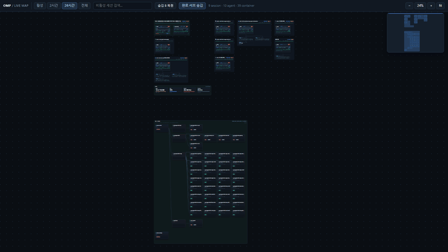
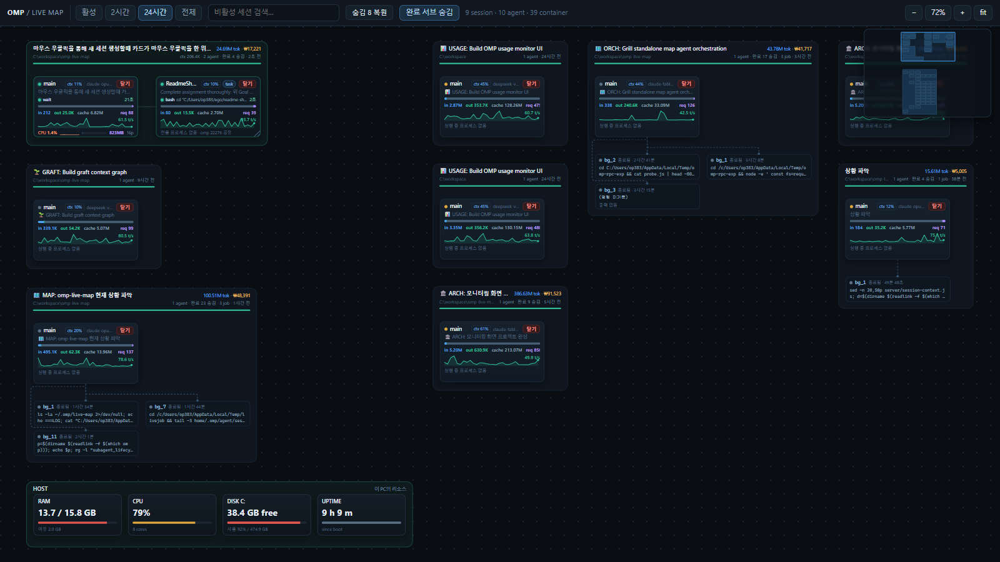
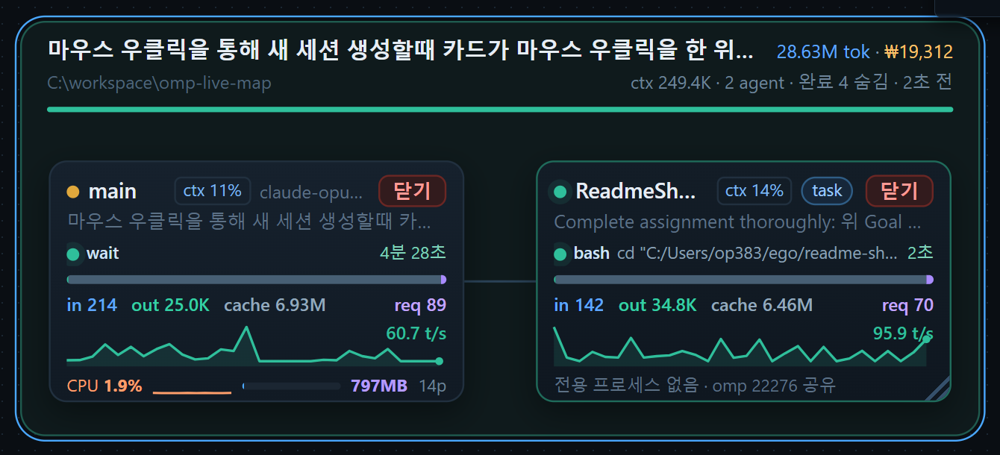
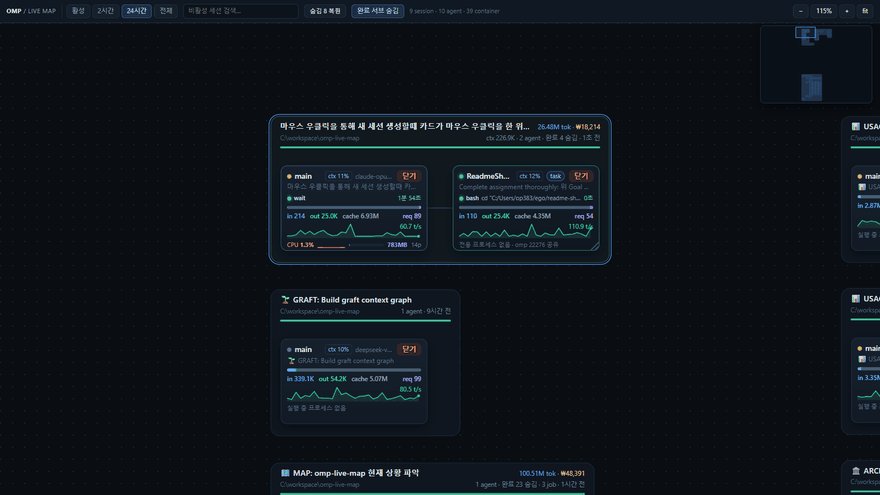
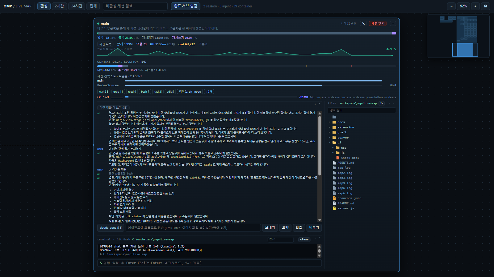
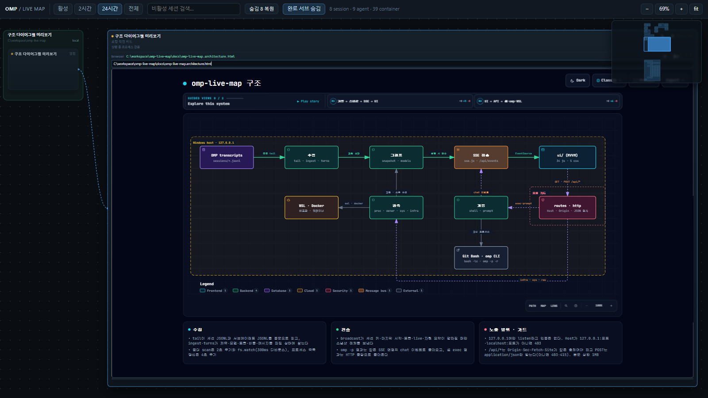
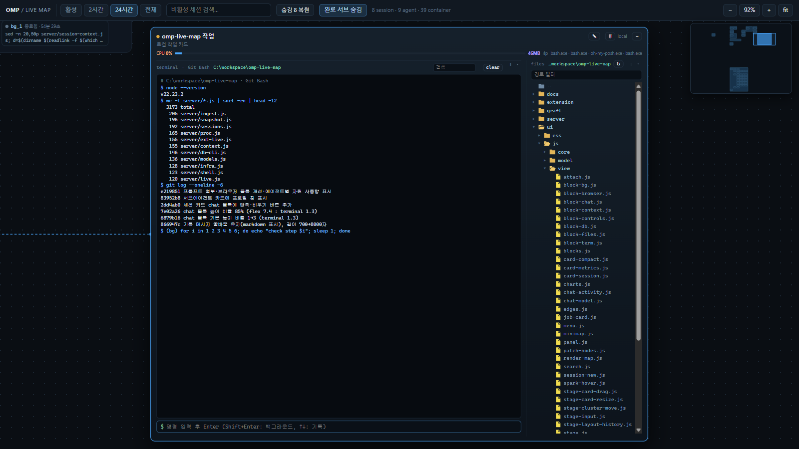

# omp-live-map

OMP 에이전트 세션을 터미널 스크롤 대신 지도 한 장으로 보는 개인용 관제 화면입니다.



이 PC에서 도는 OMP 세션·서브에이전트의 상태, 토큰·비용·컨텍스트 소비, 프로세스 자원을 실시간으로 보여 주고, 브라우저에서 바로 프롬프트 전송·셸 명령·프로세스 정리를 합니다.

- 의존성 없음. Node 내장 모듈만 씁니다(Node 22 이상. 컨텍스트 상한 조회에 `node:sqlite`를 씁니다. 없으면 사용률만 빠집니다).
- `127.0.0.1`에만 바인드합니다. 로컬 1인 사용을 전제로 하며 로그인은 없습니다.
- Windows + Git Bash + WSL 환경에 맞춰져 있습니다.

## 무엇을 하나

### 세션 전체를 지도 한 장으로



최근 활동한 세션마다 클러스터가 하나씩 생기고, 그 안에 main 에이전트와 서브에이전트, 백그라운드 잡이 선으로 이어진 트리로 놓입니다. HOST 카드는 이 PC의 RAM·CPU·디스크·가동 시간을, WSL·Docker 카드는 배포판과 컨테이너 상태를 보여 줍니다. 위쪽 `활성`·`2시간`·`24시간`·`전체` 버튼으로 기간을 고르고, 휠로 확대·축소하고 빈 바탕을 끌어 이동합니다. 오른쪽 위 미니맵에 지금 보는 범위가 표시됩니다.

Compose 프로젝트 카드에서 `start`를 누르면 해당 프로젝트를 `docker compose up -d`로 실행합니다. WSL·Compose·컨테이너 동작 버튼은 요청과 상태 조회가 끝날 때까지 진행 상태를 표시하고 중복 실행을 막습니다. 실패하면 오류를 알립니다.

### 에이전트 카드



작은 카드 하나가 에이전트 하나입니다. 상태 점(진행 중·대기·끝남), 컨텍스트 사용률, 모델, 지금 돌고 있는 툴과 경과 시간, 입력·출력·캐시 토큰과 요청 수, 턴별 출력 속도 추세가 들어 있고, 세션 프로세스의 CPU·메모리·프로세스 수가 맨 아래에 붙습니다. 서브에이전트 카드에는 프로필(`task`, `scout` 등)이 칩으로 표시됩니다.

### 카드를 열어 대화·지표 보기





카드를 더블클릭하면 같은 지도 위에 큰 카드가 열리고, 원래 자리에는 미러 카드가 남아 점선으로 이어집니다. 위쪽에는 누적 토큰 구성·비용·ttft·컨텍스트 구성(대화·툴 스키마·시스템)·세션 안 에이전트별 컨텍스트·툴 사용 횟수·프로세스 자원이, 아래쪽에는 블록이 놓입니다. 세션 카드의 기본 블록은 대화 기록(채팅), Git Bash 터미널, 세션 폴더의 파일 트리입니다.

대화 블록은 응답 생성이나 도구 작업이 진행 중일 때 입력창 위에 상태를 표시합니다. 터미널에서 시작한 세션은 실시간 활동 확장이 보낸 이벤트를 기준으로 표시합니다.

### 하네스 선택: omp · Claude Code

카드에는 그 세션을 만든 하네스 칩(`omp` / `Claude`)이 붙습니다. 새 세션 창의 **하네스**에서 고르고, 마지막 선택은 브라우저에 기억됩니다.

- **omp**(기본): 지금까지와 같습니다. `omp --mode rpc-ui`로 띄우고 압축·비우기·모델 변경·ask를 모두 씁니다.
- **Claude Code**: `~/.claude/projects/<슬러그>/<sessionId>.jsonl`을 **읽기 전용**으로 읽어 카드로 그립니다(제목·대화·cwd·토큰·비용·툴). 서브에이전트 기록(`<sessionId>/subagents/agent-*`)도 메인 아래 카드로 그려 실행 중이면 자동 도킹·완료 시 자동 닫힘합니다.
- 프롬프트는 `claude -p --output-format stream-json --include-partial-messages`로 보내고, 이어가기는 `--resume <sessionId>`, 취소는 프로세스 종료입니다. 모델 변경은 다음 실행에 `--model <별칭>`으로 넘깁니다(카드별 저장). 첨부 이미지는 stream-json 입력의 이미지 블록으로, 일반 파일은 임시 경로에 저장해 `@경로`로 참조합니다.
- **비우기**는 계보(lineage)에 다음 세션 파일을 적어 카드 id·자리·메모를 유지한 채 빈 세션으로 잇습니다. **압축**은 `/compact [지시문]`을 프롬프트로 보냅니다(Claude Code `-p` 모드의 슬래시 명령 지원 여부는 [미확인]). **ask**는 스트림의 `AskUserQuestion` tool_use를 기존 질문 카드로 띄우고, 고른 답을 다음 프롬프트로 보냅니다.
- Claude Code에는 없는 기능: 컨텍스트 구성 조회(대화·툴 스키마·시스템 토큰 분해). 이 블록은 Claude 카드 메뉴에 나오지 않습니다.
- **하네스 전환**: 카드 우클릭 메뉴에서 반대 하네스로 옮길 수 있습니다. 원래 세션의 요약(요약 모델 실패 시 대화 발췌)을 넘겨 같은 cwd 에 새 세션을 시작하고, 계보(lineage)로 카드 id·별칭·메모·위치·블록을 그대로 유지합니다. 원래 기록은 지도에서 숨고(파일은 남음), 원래 omp rpc 는 자원을 정리합니다. 도는 턴이 있으면 전환하지 않습니다. 양방향 반복 전환할 수 있습니다.
- Claude Code 실행에는 `claude` CLI가 PATH에 있어야 합니다. 없으면 카드에서 "claude 실행 실패"로 알립니다.

### 브라우저 블록



개발 서버 주소(`http://127.0.0.1:8080` 등)나 로컬 html 경로를 넣으면 카드 안 iframe으로 띄웁니다. 블록을 추가하면 카드가 1920×1080 크기로 맞춰집니다. 위 화면은 `docs/omp-live-map.architecture.html`을 연 모습입니다.

### 로컬 작업 카드: 터미널과 파일 트리



세션과 상관없는 작업 카드를 Ctrl+N이나 빈 바탕 우클릭으로 만듭니다. 터미널은 Git Bash로 명령을 실행하고(Shift+Enter는 백그라운드 잡), 파일 트리는 카드 폴더를 펼쳐 봅니다. 블록은 카드 우클릭 메뉴에서 더하고 뺍니다(터미널·백그라운드 잡·파일 트리·브라우저·DB 조회).

세션 닫기와 `프로세스 정리만`은 해당 카드에서 맵이 실행한 백그라운드 잡과 그 자식만 정리합니다. 같은 폴더의 다른 터미널이나 세션은 폴더 경로만으로 종료하지 않습니다. 맵이 소유한 OMP 세션은 세션 닫기에서 별도로 종료합니다.

## 실행

```bash
node server.js --port 7800 --hours 24
# http://127.0.0.1:7800
```

| 옵션·환경변수 | 기본값 | 내용 |
|---|---|---|
| `--port` | 7800 | 서버 포트 |
| `--hours` | 24 | 스냅샷에 넣을 세션의 최근 활동 범위(시간) |
| `OMP_MAP_BASH` | `C:\Program Files\Git\bin\bash.exe` | 터미널·백그라운드 잡에 쓰는 bash |
| `OMP_MAP_CWD` | 프로젝트 폴더의 부모 | 새 로컬 카드의 기본 폴더 |
| `OMP_USD_KRW` | 1390 | 비용 원화 환산 환율 |
| `OMP_LLM_BASE_URL`, `OMP_LLM_API_KEY`, `OMP_LLM_MODEL` | `~/.omp/agent/models.yml`의 provider | 세션 요약(`/api/summary`)에 쓰는 OpenAI 호환 엔드포인트 |
| `OMP_SUMMARY_MODEL` | provider 기본 모델 | 요약 모델만 따로 지정 |

`ui/` 파일은 요청할 때마다 디스크에서 읽으므로 새로고침하면 반영됩니다. `server.js`와 `server/`를 고치면 서버를 다시 띄워야 합니다.

## 터미널 세션 실시간 표시(확장)

TUI에서 연 omp 세션의 기록 파일은 0.3초 안에 읽히지만, 진행 중인 bash 출력은 툴이 끝날 때 한 번에 기록에 남습니다. 그래서 omp 확장 `extension/live-map.ts`가 세션 안에서 툴 진행 프레임(백그라운드 잡 포함)과 에이전트 글을 직접 받아 `~/.omp/live-map/<세션>.jsonl`로 흘리고, 서버의 `server/ext-live.js`가 그 파일을 tail 해 기존 live 이벤트로 방송합니다.

설치(omp가 `~/.omp/agent/extensions/`를 자동으로 읽으므로 설정 파일은 건드리지 않습니다):

```bash
node extension/install.js
```

적용은 **새로 연 세션부터**입니다. 이미 떠 있는 TUI 세션은 다시 시작해야 확장이 붙습니다. 서버도 `server/ext-live.js`를 읽도록 재시작해야 합니다.

- 기록은 툴 호출별로 늘어난 출력의 끝 8000자, 파일 하나가 2MB를 넘으면 새로 시작합니다. 확장은 TUI와 같은 프로세스에서 도므로 처리를 모두 try/catch로 감싸고 디스크 쓰기만 비동기 큐로 묶습니다.
- 맵이 직접 띄운 rpc 세션은 프레임이 원천이므로 확장 기록은 건너뜁니다(중복 표시 없음). 서버를 새로 켜도 최근 10분 활동은 새로 붙은 화면에 되살아납니다.

## 화면

요소 계층은 스테이지(맵) → 클러스터 → 카드 → 블록입니다.

- **클러스터**: 세션 하나(main + 서브에이전트 트리 + 백그라운드 잡), WSL·Docker, HOST(RAM·CPU·디스크·가동 시간), 로컬 작업 카드.
- **작은 카드**: 에이전트 하나의 요약. 상태 점, 컨텍스트 사용률, 토큰 구성, 턴당 출력 추세, 세션 프로세스 CPU·메모리.
- **큰 카드**: 카드를 더블클릭하면 열립니다. 위쪽(chrome)은 토큰·비용·ttft·컨텍스트·툴 사용·자원 지표, 아래쪽(body)은 블록입니다. 열린 카드 자리에는 미러 카드가 남습니다.
- **블록**: `chat`(대화 기록, 프롬프트 전송·취소·요약), `terminal`(Git Bash), `bg`(백그라운드 잡 출력), `files`(파일 트리), `browser`(개발 서버 미리보기), `db`(SQLite·MySQL·MariaDB·Oracle 조회), `context`(지금 세션이 실어 나르는 컨텍스트 — 압축 요약·메시지·툴 결과를 순서대로, 항목별 토큰 수와 함께. 작업 가이드 전송·선택 항목을 뺀 압축). 카드 우클릭 메뉴에서 추가·제거하고, 블록마다 접기·순서 변경·높이 조절을 합니다.

| 조작 | 동작 |
|---|---|
| 카드·클러스터 제목 클릭 | 클러스터 선택 (Shift+클릭: 다중 선택) |
| 카드 더블클릭 | 큰 카드 열기. 미러 카드 더블클릭 또는 Esc: 닫기 |
| 작은 카드·미러 카드·클러스터 제목 끌기 | 선택된 클러스터 이동. 열린 큰 카드는 제자리 |
| 큰 카드 끌기 | 큰 카드와 그 클러스터가 함께 이동 |
| Ctrl+Z | 배치 되돌리기 |
| 휠 / `+` `-` `0` `1` | 확대·축소 / 전체 보기 / 100%. 카드 안 스크롤 영역에서는 그 영역이 스크롤됩니다 |
| 빈 바탕 끌기, Space+끌기, 가운데 버튼 | 화면 이동 |
| 우클릭 | 카드 메뉴(블록, 세션 프로세스 종료, 숨기기, 고정) / 빈 바탕 메뉴 |
| Ctrl+N | 로컬 작업 카드 추가 |
| 터미널 Enter / Shift+Enter / ↑↓ | 실행 / 백그라운드 실행 / 명령 기록 |
| 채팅 Ctrl+Enter | 그 세션에 프롬프트 전송(`omp -p -r <세션 파일>`) |
| 채팅·새 세션 입력창 Ctrl+V / 파일 끌어 놓기 | 이미지·파일 첨부(입력창 아래 칩, ×로 빼기). 전송한 이미지는 대화 기록에도 표시합니다. 파일당 20MB, 합계 60MB, 10개까지. 넘으면 칩에 오류를 띄우고 보내지 않음 |
| 토큰 바 클릭 | 세션 누적 ↔ 최근 1시간 |
| 툴 칩 클릭 | 대화를 그 툴을 쓴 턴으로 거르기 |
| 세션 컨텍스트 행 클릭 | 그 에이전트 카드로 이동 |
| 이름 더블클릭 또는 ✎ | 카드 이름 바꾸기(비우면 원래 이름) |

배치·숨김·고정·이름·블록 구성은 브라우저 `localStorage`(`omp-map-*`)에 저장됩니다.

## 구조

```
server.js              진입점: 주기 스캔, fs.watch, listen
server/
  config.js            경로·포트·상수
  tail.js ingest.js turns.js     기록 수집: 증분 읽기 → 이벤트 반영 → 대화·시간당 토큰
  snapshot.js models.js          세션/노드 그래프, 컨텍스트 상한 조회, 요약 호출
  proc.js owner.js sys.js infra.js   프로세스·세션 소유 프로세스·호스트·WSL/Docker 관측
  shell.js prompt.js             Git Bash 실행, 백그라운드 잡, omp 프롬프트 전송·취소
  sse.js http.js routes*.js      SSE 방송, 요청 가드, 라우트
  active.js ext-live.js          실시간 방송: 기록 이벤트, 확장 기록(~/.omp/live-map) tail
  uploads.js                     프롬프트 첨부: 작은 이미지는 rpc `images`, 나머지는 %TEMP%\omp-live-map-uploads\ 에 저장해 경로를 메시지에 붙임
extension/
  live-map.ts          omp 확장: 세션의 툴 출력·글을 ~/.omp/live-map 으로(설치: install.js)
ui/
  index.html           스크립트를 계층 순서로 적재(번들러·프레임워크 없음)
  css/                 tokens · shell · cards · panel · blocks
  js/core/             format · dom · state(가변 상태 단일 소유) · persist(localStorage)
  js/model/            layout(배치 계산, DOM 접근 없음)
  js/viewmodel/        map · store · term · files · dbui · chat · context
  js/view/             맵(render-map, patch-nodes, stage*, edges, minimap, menu, search, topbar)
                       카드(card-compact, card-session, card-metrics, charts, spark-hover, panel)
                       블록(blocks, block-controls, block-chat/term/bg/files/browser/db/context)
  js/app.js            부트스트랩: 첫 스냅샷 → SSE → 폴러
docs/                  archify 구조 다이어그램(architecture · components · layers · ui), media/(README 이미지·GIF)
```

규칙:

- 의존 방향은 core → model → viewmodel → view → app 한쪽입니다. model은 DOM을 모르고 view만 DOM을 만집니다.
- 파일 하나는 200줄 미만으로 유지합니다.
- 서버의 가변 상태는 모듈 하나가 소유하고 함수로만 내보냅니다(예: 파일 상태 Map은 `tail.js`).
- 화면은 `renderMap()`이 조각 목록을 만들고 `patchPieces()`가 마크업이 바뀐 조각만 바꿉니다. 큰 카드는 스냅샷이 올 때 chrome만 교체하고, 블록이 사는 body는 블록 구성이 같으면 DOM을 유지합니다. 그래서 입력 포커스·스크롤·트리 펼침이 갱신에 끊기지 않습니다.
- 새 블록은 `ui/js/view/block-<이름>.js`에서 `registerBlock({ type, slot, flex, render, mount, paint })`로 등록하고 `index.html`에 스크립트를 추가합니다. `render`는 바디를 만들 때, `mount`는 그 직후 1회, `paint`는 스냅샷 갱신 때 불립니다.

## 데이터와 API

기록의 원본은 `~/.omp/agent/sessions/<폴더>/<세션>.jsonl`과 서브에이전트 `<세션>/<Agent>.jsonl`입니다. 서버는 읽기만 하고 상태를 메모리에만 둡니다. 서버를 다시 띄우면 기록에서 다시 만듭니다.

| 경로 | 내용 |
|---|---|
| `GET /api/graph` | 스냅샷 `{generatedAt, fx, env, sessions[]}` |
| `GET /api/events` | SSE. 스냅샷(바뀔 때만)과 `{chat: {node, kind: req\|delta\|done, text, code, cancelled}}` |
| `POST /api/prompt` `{node, text, files?[{name, mimeType, data(base64)}]}` | 세션에 프롬프트 전송. 노드당 1개만 실행(`busy`). PNG·JPEG·GIF·WebP 는 base64 합계 900KB까지 omp rpc `images` 로 싣고(rpc v1 입력 프레임 1MiB), 그 밖의 파일·넘친 이미지는 `%TEMP%\omp-live-map-uploads\<id>\` 에 저장해 메시지 끝에 절대 경로를 붙임. 본문 상한 100MB(다른 API는 1MB). `POST /api/session/new` `{cwd, text, files?}` 도 같음 |
| `POST /api/prompt/cancel` `{node}` | 실행 중인 프롬프트의 프로세스 트리를 끝냄. 대기 중인 `/api/prompt` 응답과 SSE가 `code 130, cancelled`로 끝남 |
| `POST /api/session/models` `{node}` | 사용 가능한 모델 목록과 현재 모델 `{ok, models[{provider,id,name}], current, busy}`. 맵 세션이 아니면 이어 붙이고, 터미널이 쥔 세션은 `{ok:false, held:true}` |
| `POST /api/session/model` `{node, provider, id}` | 모델 변경(omp rpc `set_model`). 응답 `{ok, model, busy}`. 도는 중이면 다음 턴부터 적용 |
| `GET /api/context?node=` | 그 세션의 지금 컨텍스트 `{ok, items[{i, kind, label, text, tokens, chars, trunc, tool?, tools?, error?}], count, totalTokens, owned}`. 기록에서 마지막 `compaction`(없으면 `reset_boundary`) 이후만 복원하고, 토큰은 표시용 근사치(한글·CJK 1자≈1, 그 외 4자≈1) |
| `POST /api/context` `{node, mode, text, omit?}` | `mode:"guide"` = 작업 가이드를 프롬프트로 전송(도는 중이면 steer). `mode:"compact"` = omp `compact` 에 `customInstructions` 로 가이드+제외 항목 설명을 넘겨 압축(맵이 쥔 세션만, 터미널이 쥐면 `{ok:false, held:true}`) |
| `POST /api/summary` `{node}` | 최근 대화 3줄 요약 |
| `POST /api/exec` `{cwd, cmd}` | Git Bash 명령 실행(20초 제한). 서버는 cwd를 기억하지 않고, `cd`는 새 cwd를 응답으로 돌려줌 |
| `POST /api/db/query` `{type, host, port, database, user, password, path, sql}` | DB 조회 한 문장. 응답 `{ok, columns, rows, total, truncated, changes, ms, error, reason, hint}`. `type`은 `sqlite`\|`mysql`\|`mariadb`\|`oracle`, `path`는 SQLite 파일. SQLite는 내장 `node:sqlite`(없으면 `sqlite3` CLI), MySQL·MariaDB는 `mysql`/`mariadb` 클라이언트, Oracle은 `sqlplus`를 부릅니다. 비밀번호는 요청에만 쓰고 저장하지 않음 |
| `POST /api/bg/start` `{node, cwd, cmd}` · `GET /api/bg/list?node=` · `GET /api/bg/all` · `POST /api/bg/stop` `{id}` | 백그라운드 잡 |
| `GET /api/tree?p=&d=` | 디렉터리 트리 |
| `POST /api/editor/read` `{path}` | 파일 읽기 `{ok, path, text, mtime}`. 절대 경로만 받고 2MB 상한, 폴더·바이너리는 거부 |
| `POST /api/editor/write` `{path, text, mtime}` | 파일 저장 `{ok, mtime}`. 보낸 `mtime` 이 현재와 다르면 409(다른 곳에서 바뀜), `mtime:null` 이면 덮어씀 |
| `POST /api/editor/definition` `{path, text, line, character}` | Python 정의 위치 `{ok, locations[{path, line, character}]}`. pyright-langserver 를 워크스페이스 루트별로 띄워 처리(0-based) |
| `POST /api/editor/diagnostics` `{path, text}` | Python 진단 `{ok, items[{line, character, endLine, endCharacter, severity, message}]}`. `publishDiagnostics` 를 15초까지 기다림 |
| `GET /api/editor/status` | `{ok, pyright}` — Python 언어 서버(pyright-langserver) 발견 여부 |
| `POST /api/release` `{node}` | 이 카드에서 띄운 백그라운드 잡과, 명령줄에 세션 폴더가 들어간 프로세스(자식 포함)를 종료. 세션을 돌리는 omp 프로세스와 그 자식(MCP 서버·실행기)은 건드리지 않음 |
| `GET /api/res?cwd=&node=` · `GET /api/proc` · `GET /api/sys` | 자원·프로세스·호스트 |
| `GET /api/infra` · `POST /api/infra/action` `{kind, target}` | WSL 배포판·Docker 컨테이너 조회와 start/stop/restart, Compose 프로젝트 실행(`project-start`) |

컨텍스트 편집은 omp 가 실제로 지원하는 두 경로만 씁니다(rpc 에 메시지 삭제·수정·시스템 프롬프트 교체 명령이 없습니다): 작업 가이드 프롬프트/steer 와 `compact` + `customInstructions`. 기록 파일(.jsonl)은 직접 고쳐 쓰지 않습니다.

스냅샷 노드의 주요 필드: `id`(기록 파일 경로), `kind`(main\|sub), `parent`, `status`(live\|idle\|done), `tokens`, `tokens1h`, `cost`, `auxCost`, `ctx`, `ctxWindow`, `series`, `tools`, `messages[{role, text, ts, tools?, n?}]`, `res{cpu, mb, proc, procs, owner, hist}`.

세션과 프로세스는 omp 본체 프로세스의 명령줄(세션 id·파일 경로) 또는 생성 시각(세션 시작 15초 전~3초 후)으로 잇습니다. 카드의 CPU·메모리는 이 프로세스와 자식 전체의 합입니다. omp 안에서 `/new`로 만든 세션이나 id 없이 이어 쓴 세션은 소유 프로세스를 찾지 못해 공유 프로세스 합계만 보이고, 그 omp 프로세스는 처음 시작한 세션 카드에 계속 잡힙니다.

## 코드 편집기

파일 트리에서 파일을 우클릭해 **편집기로 열기**를 고르면 전체 화면 편집기가 열립니다(닫기 버튼·Esc). Monaco Editor 를 jsDelivr CDN 에서 편집기를 처음 열 때만 받으므로 npm 의존성은 없고, 오프라인이면 열리지 않습니다. 테마는 `vs-dark`, 파일마다 탭이 생기고 상단에 경로·저장 상태·문제 개수가 보입니다.

- `Ctrl+S`: 저장. 읽을 때 받은 `mtime` 과 현재가 다르면(다른 곳에서 수정) 409 로 알리고 덮어쓸지 묻습니다.
- `F12`·`Ctrl+클릭`: 정의로 이동. Python 은 `pyright-langserver --stdio`(PATH 또는 `C:\Users\op383\AppData\Local\Programs\Python\Python39\Scripts\pyright-langserver.exe`)를 파일의 프로젝트 루트마다 하나 띄워 씁니다. 다른 파일의 정의면 그 파일을 탭으로 열고 위치로 이동합니다. JS/TS 는 Monaco 내장 TypeScript 서비스로 같은 파일의 정의로 이동합니다.
- 진단: Python 은 입력이 멈춘 뒤 약 600ms 후 서버에 물어 빨간 밑줄을 긋고, JS/TS 문법 오류는 Monaco 가 스스로 표시합니다. 그 밖의 언어는 구문 강조만 합니다.
- Python 언어 서버가 없으면 편집·저장은 그대로 되고 상단에 `Python 언어 서버 없음` 이 표시됩니다. 언어 서버 프로세스는 5분 유휴 시 스스로 종료합니다.

## 보안

이 서버는 셸 명령 실행과 에이전트 프롬프트 전송을 그대로 받습니다. 방어는 세 가지입니다.

- `127.0.0.1`에만 바인드합니다. 다른 PC에서는 접속할 수 없습니다.
- 모든 요청에서 `Host`가 `127.0.0.1:<포트>` 또는 `localhost:<포트>`인지 확인합니다(DNS rebinding 차단).
- `/api/*`는 `Origin`·`Sec-Fetch-Site`가 같은 출처일 때만 받고, POST는 `Content-Type: application/json`만 받습니다. 브라우저에서 연 다른 사이트가 이 서버로 명령을 보낼 수 없습니다.

이 PC에 로그인한 다른 프로그램은 막지 못합니다. 포트를 외부에 열거나 프록시 뒤에 두지 마세요.

DB 연결 프로필은 브라우저 `localStorage`(`omp-map-dbprofiles`)에 유형·host·port·database·user·path 만 저장하고 비밀번호는 저장하지 않습니다. 비밀번호는 `/api/db/query` 요청 본문으로만 오가며, MySQL·MariaDB 에서는 프로세스 목록에 남지 않도록 `MYSQL_PWD` 환경변수로, Oracle 은 `sqlplus` 인자로 넘깁니다.

## 검증

자동 테스트는 없습니다. 고친 뒤에는 다음을 확인합니다.

```bash
for f in server.js server/*.js ui/js/*.js ui/js/*/*.js; do node --check "$f"; done
wc -l server.js server/*.js ui/js/*.js ui/js/*/*.js | sort -rn | head   # 200줄 미만
node server.js --port 7806      # 운영 포트와 다른 포트로 띄워 화면에서 확인
```

프롬프트 전송을 실제 비용 없이 확인하려면, JSON 줄을 출력하는 가짜 `omp.exe`를 PATH 맨 앞에 두고 테스트 서버를 띄웁니다.
