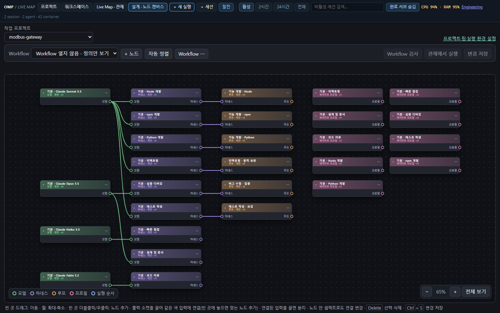
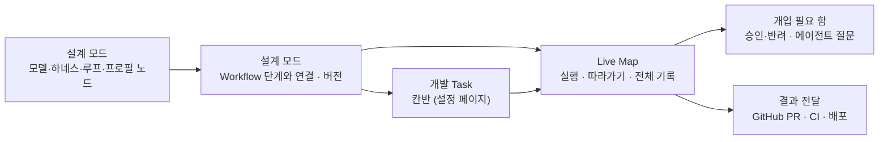
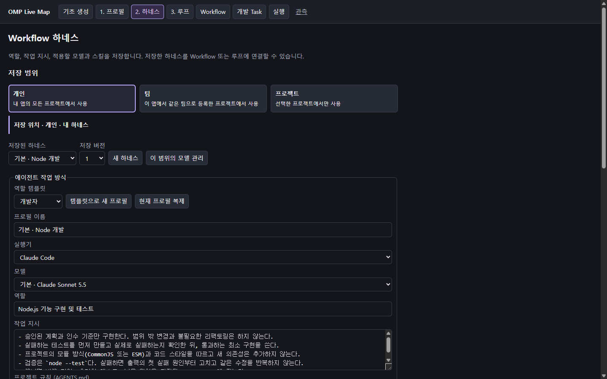
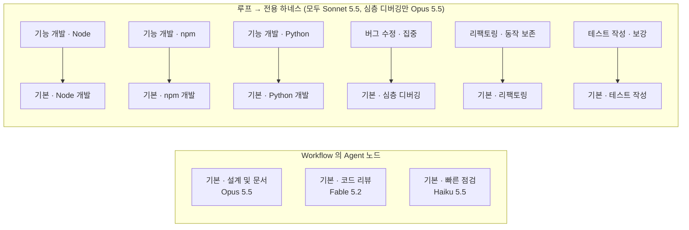
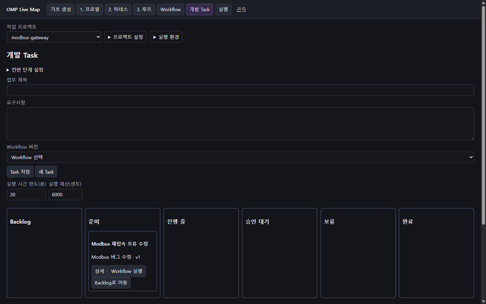

# Engineering: 에이전트 업무를 Workflow로 수행하기

Engineering은 에이전트(OMP·Claude Code)에게 개발 업무를 맡기고, 사람이 승인·개입하는 지점을 Workflow로 정해 두는 기능입니다. **Windows 데스크톱 앱에서만** 데이터를 읽고 씁니다. 웹 모드에서는 화면만 열리고 `/api/engineering/*`가 403입니다.

모든 편집과 실행은 **관제 화면 한 곳**에서 합니다. 위쪽 모드에서 **설계 · 노드 캔버스**(<kbd>Alt</kbd>+<kbd>4</kbd>)로 모델·하네스·루프·프로필·Workflow를 노드로 편집하고, **Live Map · 관제**(<kbd>Alt</kbd>+<kbd>3</kbd>)에서 실행을 보고 개입합니다. 정의를 폼으로 고치는 화면은 없습니다. **Engineering** 링크는 프로젝트·팀·실행 환경 설정과 개발 Task, Loop 실행만 담은 설정 페이지입니다.

## 한 장으로 보는 흐름

| 어디서 | 하는 일 | 저장되는 것 |
|---|---|---|
| 설계 모드 · 정의 노드 | 모델, 하네스(역할·지시·AGENTS.md·자료·스킬·결과 형식·MCP/Hooks 초안), 루프(재시도·한도·검증 명령), 에이전트 프로필을 노드 안에서 고칩니다. 노드 메뉴 **상세**에서 버전 기록·실제 적용값·사용 중 Workflow·비교 실행을 봅니다. | 정의·프로필 버전 |
| 설계 모드 · Workflow | 단계 노드와 연결로 업무 흐름을 그리고 검사 후 새 버전으로 저장합니다. **Workflow ⋯**에서 기본 8종 추가·JSON 내보내기·가져오기. | Workflow 버전, 템플릿 |
| 설정 페이지 · 개발 Task | 업무를 칸반으로 관리하고 Workflow 버전과 한도를 고정해 실행합니다(실행은 관제에서 열림). | Task, 단계 설정 |
| Live Map | 시작·진행 확인·승인·재시도·수정 요청·일시정지·취소·결과 전달을 합니다. | 실행 기록, 단계별 수행 내역, 산출물, 감사 이벤트 |

## 설계 모드 (노드 캔버스)

관제 화면 위쪽 모드에서 **설계 · 노드 캔버스**를 누릅니다(<kbd>Alt</kbd>+<kbd>4</kbd>). ComfyUI처럼 노드를 선으로 잇고, 노드 안의 셀렉트·입력칸으로 모델, 하네스, 루프, 에이전트 프로필, Workflow 단계를 한 곳에서 편집합니다. 관제(Live Map)로 갔다 와도 편집 중인 캔버스와 프로젝트 선택은 그대로입니다. 작업 프로젝트는 캔버스 위 **작업 프로젝트**에서 고릅니다.

- **첫 화면**: Workflow를 열지 않으면 정의를 접어 목록처럼 보여 주고, 단계에 연결되지 않은 프로필은 오른쪽에 격자로 둡니다. Workflow를 열면 그 Workflow에 연결된 노드를 70% 이상으로 맞추고 나머지는 접습니다. **전체 보기**는 배율과 관계없이 모두 넣습니다.

| 소켓 색 | 연결 | 의미 |
|---|---|---|
| 초록 | 모델 → 하네스 | 하네스가 쓸 모델. **같은 저장 범위**끼리만 연결됩니다. |
| 보라 | 하네스 → 루프, 하네스 → Agent 단계 | 루프가 실행할 하네스, Agent 단계가 쓸 하네스(버전 고정). |
| 주황 | 루프 → Loop 단계 | Loop 단계가 쓸 루프(버전 고정). |
| 분홍(점선) | 프로필 → Agent 단계 | 연결하면 하네스 대신 프로필로 실행합니다. |
| 하늘 | Workflow 단계 → 단계 | 실행 순서. 출력(다음·참/거짓·승인/거절)마다 다음 단계 하나를 잇습니다. |

- **연결**: 출력 소켓을 끌어 같은 색 입력 소켓(또는 노드 본문)에 놓습니다. 노드 안 입력 줄의 셀렉트로 골라도 같은 연결이 됩니다. 빈 곳에 놓으면 그 소켓에 맞는 노드만 고르는 메뉴가 열리고, 고른 노드에 바로 연결됩니다.
- **분리**: 연결된 입력 소켓을 끌면 선이 떼어져 다른 곳에 꼽을 수 있습니다. 선을 한 번 누르면 선택(<kbd>Delete</kbd>로 끊기), 빠르게 두 번 누르면 바로 끊습니다.
- **추가**: 빈 곳 더블클릭·우클릭 또는 **+ 노드**. 검색어를 입력하고 Enter로 첫 항목을 넣습니다. 하네스는 개발자·코드 리뷰어·문서 작성자 템플릿으로 시작할 수 있고, 새 정의 노드는 노드 안 **저장 범위** 셀렉트로 개인·팀·프로젝트를 고릅니다.
- **되돌리기**: 저장하기 전의 캔버스 편집(노드 추가·삭제, 연결, 이동, 값 변경)은 <kbd>Ctrl</kbd>+<kbd>Z</kbd>(다시 실행 <kbd>Ctrl</kbd>+<kbd>Shift</kbd>+<kbd>Z</kbd>) 또는 도구 모음의 ↶ ↷로 되돌립니다. 입력칸 안에서는 글자 되돌리기가 먼저입니다. 서버에서 지운 정의와 다른 Workflow·프로젝트로 바꾸기 전의 편집은 되돌릴 수 없습니다.
- **저장**: 노드 아래 **저장 / 새 버전 저장**, 또는 위의 **변경 저장 (n)**·<kbd>Ctrl</kbd>+<kbd>S</kbd>로 바뀐 것을 모두 저장합니다. 모델 → 하네스 → 루프 → 프로필 → Workflow 순서로 저장하므로 아직 저장하지 않은 노드끼리 연결해 두어도 됩니다. 하네스·루프·프로필을 새 버전으로 저장하면, 이전 최신 버전에 고정돼 있던 Workflow 단계는 새 버전을 쓰도록 바뀝니다(Workflow를 저장해야 반영). 어느 버전에 고정할지는 단계 노드의 **고정 버전** 셀렉트로 바꿉니다.
- **표시 범위**: Workflow를 열면 그 Workflow가 쓰는 정의만 보입니다(**연결된 정의만**). **전체 정의**를 누르거나 추가 메뉴의 **저장된 정의 불러오기**로 다른 정의를 캔버스에 올립니다. Workflow를 열지 않으면 모든 정의가 보입니다.
- **검사·실행**: **Workflow 검사**는 저장 없이 실행 계획을 확인하고, 연결이 빠진 단계가 있으면 이유를 한국어로 알려 주며 그 단계를 고릅니다. **관제에서 실행**은 Live Map으로 돌아가 이 Workflow를 고른 새 실행 대화상자를 엽니다. 반대로 Live Map 실행 상세의 **설계에서 편집**은 그 실행의 Workflow를 여기서 엽니다.
- **Workflow ⋯**: 기본 Workflow 8종 추가, 열려 있는 Workflow를 JSON으로 내보내기, JSON에서 가져오기(같은 이름이 있으면 '(가져옴)'을 붙임).
- **배치**: 노드 제목을 끌어 옮기고, ▾로 접습니다. 정의 노드 위치는 Workflow마다 따로 기억하고(이 PC의 브라우저 저장소), Workflow 단계 위치는 Workflow 버전에 저장됩니다. **자동 정렬**은 정의 노드를 쓰는 단계 높이에 맞춰 다시 놓습니다.
## 노드 상세 (버전 기록 · 실제 적용값 · 비교 실행)

정의 노드의 ⋯ 메뉴에서 **상세**를 고르면 캔버스 오른쪽에 상세 패널이 열립니다.

- **버전 기록**(모든 정의): 저장된 버전을 골라 내용을 보고, **이 버전을 초안으로 불러오기**로 되돌린 뒤 새 버전으로 저장합니다.
- **실제 적용값**(하네스): 편집 중 초안 또는 저장 버전이 실행기에 전달될 프롬프트 순서와 설정(모델·작업 폴더·도구·저장소 자료의 커밋·SHA-256)을 확인합니다.
- **사용 중인 Workflow**(하네스): 작업 프로젝트에서 이 하네스를 쓰는 단계를 보고, 최신 버전을 **vN 적용**으로 그 Workflow에 새 버전으로 반영합니다(루프를 거치면 루프도 새 버전).
- **같은 입력으로 비교 실행**(하네스): 기준 버전과 초안을 같은 커밋·같은 입력으로 각자 격리된 worktree에서 실행해 비교합니다. 예산은 함께 소비합니다.
- 하네스 노드 안에서 고치는 항목: 저장 범위(개인·팀·프로젝트, 새 노드일 때), 실행기, 역할, 작업 지시, 프로젝트 규칙(AGENTS.md), 저장소 파일·Workflow 입력, 스킬(최대 5개), 결과 형식·파일·필수 필드, MCP·Hooks 초안. 역할 템플릿(개발자·코드 리뷰어·문서 작성자)은 **+ 노드** 메뉴의 '새 하네스 · …'로 고릅니다.
- 팀 범위를 쓰려면 설정 페이지의 **프로젝트 설정 → 새 팀 등록**으로 팀을 만들고 프로젝트의 팀 이름에 넣습니다.

## Workflow

노드 종류: `Start`, `End`, `Agent`(프로필 또는 하네스), `Loop`, `Command`(검증 명령), `Approval`(승인·반려), `Condition`, `Parallel`/`Join`, `Subgraph`(다른 Workflow 호출), `Profile`(Agent에 연결하는 프로필 노드).

- 그래프에는 Start와 End가 각각 하나여야 합니다. 순환, 없는 포트, 잘못된 계약은 실행 계획 확인에서 거부합니다.
- 저장하면 새 버전이 됩니다. **과거 실행은 시작한 버전을 그대로 유지**합니다.
- 템플릿 내보내기·가져오기는 런타임 ID를 프로젝트 참조로 바꾸고, 자격 증명이 들어 있으면 거부합니다.

### 기본 제공 Workflow

템플릿 8종은 단계마다 맡는 하네스가 정해져 있습니다. 설계·문서는 **기본 · 설계 및 문서**, 리뷰는 **기본 · 코드 리뷰**, 분류는 **기본 · 빠른 점검**, 작업 및 검증은 루프(아래 표)가 맡습니다. 노드 지시문은 한국어로, 하네스의 역할과 이어지게 썼고, 승인 단계에는 확인할 항목을 번호로 적었습니다.

| 템플릿 | 단계 (괄호는 맡는 하네스·루프) | 처음 고르는 루프 |
|---|---|---|
| 신규 기능 개발 | 요구사항 및 계획(설계) → 설계 승인 → 작업 및 검증(루프) → 코드 리뷰(리뷰) → 최종 승인 | 기능 개발 · Node |
| 버그 수정 | 재현·원인 가설(설계) → 설계 승인 → 작업 및 검증(루프) → 코드 리뷰(리뷰) → 최종 승인 | 버그 수정 · 집중 |
| 리팩토링 | 구조 개선 계획(설계) → 설계 승인 → 작업 및 검증(루프) → 코드 리뷰(리뷰) → 최종 승인 | 리팩토링 · 동작 보존 |
| 테스트 작성 | 테스트 계획(설계) → 설계 승인 → 작업 및 검증(루프) → 코드 리뷰(리뷰) → 최종 승인 | 테스트 작성 · 보강 |
| 코드 리뷰 | 코드 리뷰(리뷰) → 최종 승인 (구현 파일 수정 없음) | 없음 |
| 기술 문서 작성 | 산출물 작성(설계) → 최종 승인 | 없음 |
| 릴리스 및 배포 | 릴리스 검증(`node --test`) → 릴리스 노트 작성(설계) → 최종 승인 | 없음 |
| 현장 장애 분석 | 관측 분류(빠른 점검) → 원인 분석 보고(설계) → 최종 승인 (읽기 전용 근거만 사용) | 없음 |

- **한꺼번에 만들기**: 설계 모드의 **Workflow ⋯ → 기본 Workflow 8종 추가**를 누르면 작업 프로젝트에 위 8개가 한 번에 만들어집니다. 필요한 개인 기본 정의가 없으면 함께 만들고, 이름이 같은 Workflow는 건드리지 않습니다.
- **템플릿으로 바로 실행**: Live Map의 **새 실행**에서 '… · 템플릿'을 고르면 설계·리뷰·점검 하네스와 루프가 위 표대로 미리 선택됩니다. 실행할 때 만들어지는 자동 사본('코드 리뷰 · 자동 사본 …')은 목록에서 따로 묶거나 숨깁니다. 점검 하네스를 고르지 않으면 설계 및 문서 하네스가 대신합니다.
### 기본 프로필, 하네스, 모델, 루프

**기본 하네스·루프 만들기**는 모델 4개, 에이전트 프로필 9개, 하네스 9개, 루프 6개를 만듭니다(모델·하네스·루프는 개인 범위, 프로필은 범위가 없는 전역 정의). 이미 같은 이름의 정의가 있으면 건드리지 않으므로 이전에 만든 기본 정의는 바뀌지 않습니다.

**하네스는 역할마다 하나, 루프는 하네스마다 하나**입니다. 모든 루프가 같은 개발 하네스를 나눠 쓰지 않고, 언어와 목적에 맞는 전용 하네스가 붙습니다.

#### 하네스

각 하네스는 역할·작업 지시 외에 **AGENTS.md 규칙**과 **스킬**(작업 절차)을 함께 싣습니다. 실행기에는 프롬프트의 일부로 전달됩니다.

| 하네스 | 모델 | 맡는 일 | 스킬 |
|---|---|---|---|
| 기본 · 설계 및 문서 | Claude Opus 5.5 | 요구사항·계획·문서. 코드를 수정하지 않음 | `acceptance-criteria` |
| 기본 · 코드 리뷰 | Claude Fable 5.2 | 변경과 테스트 증거 검토. 구현 파일 수정 없음 | `review-checklist` |
| 기본 · 빠른 점검 | Claude Haiku 5.5 | 분류·요약·로그 점검처럼 가볍고 반복적인 일 | 없음 |
| 기본 · Node 개발 | Claude Sonnet 5.5 | `node:test` 규칙에 맞춘 구현과 테스트 | `tdd-cycle` |
| 기본 · npm 개발 | Claude Sonnet 5.5 | `package.json`·잠금 파일을 건드리지 않는 구현과 테스트 | `tdd-cycle` |
| 기본 · Python 개발 | Claude Sonnet 5.5 | `unittest`·표준 라이브러리 기준 구현과 테스트 | `tdd-cycle` |
| 기본 · 심층 디버깅 | Claude Opus 5.5 | 재현과 근본 원인을 먼저 확인하는 버그 수정 | `root-cause-analysis`, `tdd-cycle` |
| 기본 · 리팩토링 | Claude Sonnet 5.5 | 동작을 바꾸지 않는 구조 개선, 단계마다 검증 | `safe-refactor` |
| 기본 · 테스트 작성 | Claude Sonnet 5.5 | 운영 코드를 수정하지 않는 테스트 보강 | `test-design` |

- 설계와 리뷰는 서로 다른 모델을 씁니다. 같은 모델이 만든 계획을 같은 모델이 검토하지 않게 하려는 구성입니다.
- 개발 하네스 3종은 자기 루프의 검증 명령(`node --test`, `npm test`, `python3 -m unittest discover`)을 지시에 그대로 적고, 언어별 규칙을 AGENTS.md로 따로 둡니다. 모든 하네스에는 "실행 환경에는 네트워크가 없다"는 규칙이 들어 있어 패키지 설치를 시도하며 시도를 낭비하지 않게 합니다.
- 모델 선택 기준은 [Anthropic 모델 개요](https://platform.claude.com/docs/en/models/overview)의 용도 설명입니다(2026-11-26 확인). Fable 5.2는 까다로운 추론과 장시간 에이전트 작업용이라 가격이 가장 높으므로 리뷰처럼 출력이 짧은 단계에 두었습니다.
- 모델 ID는 `claude-fable-5-2`, `claude-opus-5-5`, `claude-sonnet-5-5`, `claude-haiku-5-5`입니다. 이전 모델(`claude-sonnet-4-6`, `claude-haiku-4-5-20251001`)로 저장한 정의도 계속 실행됩니다. Claude Mythos 5.2는 검증된 조직 전용이라 넣지 않았습니다.

#### 루프

루프는 하네스에 시도 횟수, 시간·예산 한도, 검증 명령을 붙인 것입니다. 한 번 시도할 때마다 에이전트가 작업하고, 검증 명령이 모두 성공하면 끝납니다. 실패하면 실패 출력을 다음 시도에 넘깁니다. 시도를 다 쓰거나 시간·예산이 바닥나면 `limit_exceeded`로 멈춥니다.

| 루프 | 전용 하네스 | 시도 | 시간 | 예산 | 검증 명령 |
|---|---|---|---|---|---|
| 기능 개발 · Node | 기본 · Node 개발 | 3 | 20분 | 6,000센트 | `node --test` |
| 기능 개발 · npm | 기본 · npm 개발 | 3 | 20분 | 6,000센트 | `npm test` |
| 기능 개발 · Python | 기본 · Python 개발 | 3 | 20분 | 6,000센트 | `python3 -m unittest discover` |
| 버그 수정 · 집중 | 기본 · 심층 디버깅 | 5 | 40분 | 15,000센트 | `node --test` |
| 리팩토링 · 동작 보존 | 기본 · 리팩토링 | 3 | 30분 | 8,000센트 | `node --test` |
| 테스트 작성 · 보강 | 기본 · 테스트 작성 | 3 | 20분 | 6,000센트 | `node --test` |

- **템플릿마다 맞는 루프를 처음 고릅니다.** 기본 제공 Workflow를 만들 때 신규 기능 개발은 기능 개발 · Node, 버그 수정은 버그 수정 · 집중, 리팩토링은 리팩토링 · 동작 보존, 테스트 작성은 테스트 작성 · 보강이 미리 선택됩니다. 직접 고른 루프는 템플릿을 바꿔도 유지되고, npm·Python 프로젝트는 목록에서 해당 루프로 바꿔 고르세요.
- 검증 명령은 컨테이너가 허용하는 `node --test`, `npm test`, `python3 -m unittest discover` 세 가지뿐입니다. 버그 수정·리팩토링·테스트 작성 루프는 기본이 `node --test`이므로 다른 언어 프로젝트는 루프의 검증 명령을 바꿔 새 버전으로 저장하세요.
- **예산은 실제 비용이 아니라 호출 전에 예약하는 상한입니다**(Claude Code 구독 로그인일 때 화면에는 '호출 예약 상한'으로 표시되고, 예약이 남은 예산을 넘으면 단계가 '실행 예산 소진'으로 실패합니다). 모델을 부르기 전에 입력 토큰 수와 출력 한도로 보수적으로 계산한 금액을 예산에서 미리 뺍니다(출력은 최대 8,192토큰으로 제한). 컨텍스트 20K 토큰짜리 호출 한 번이 약 228센트를 예약하므로, 예산 100센트로는 호출을 한 번도 못 합니다. 6,000센트는 시도당 약 26회, 15,000센트는 약 65회 호출을 받아 줍니다. 실제 비용은 보통 이보다 훨씬 적고 시도 기록에 따로 남습니다.
- Workflow 실행의 예산도 같은 방식이어서 개발 Task와 **새 실행**의 기본값을 6,000센트로 두었습니다. 15,000센트짜리 루프를 쓰려면 실행 예산을 그 이상으로 올리세요.
- 입력이 10만 토큰을 넘는 호출은 거부됩니다. 읽을 자료를 작게 유지하세요.

#### 프로필 · 하네스 · 루프의 연결

- 프로필과 하네스는 **데이터로 서로를 가리키지 않습니다.** 프로필은 별도 저장소에 있고, 하네스는 Engineering 데이터베이스에 있습니다. 대신 기본 정의는 한 곳(`server/engineering/default-definitions.js`)에서 만들어 두 저장소에 같은 내용으로 넣고, 테스트가 이름·역할·지시·모델이 일치하는지 확인합니다. AGENTS.md 규칙과 스킬은 하네스에만 들어갑니다.
- 루프는 하네스만 가리키므로 프로필과는 하네스를 거쳐 이름으로 이어집니다.
- 프로필은 설계 모드의 분홍 노드로 만들고 고칩니다(폼 화면 없음).
- 프로필이 하는 일: 관제의 **새 세션**에서 고르면 역할과 작업 지시가 시스템 프롬프트로 들어가고, Workflow에서는 프로필 노드를 Agent 노드에 연결해 하네스 대신 쓸 수 있습니다. 하네스는 읽을 자료·스킬·결과 형식까지 정하고 루프와 묶입니다.
- 이미 같은 이름의 프로필이 있으면 다시 만들지 않고, 고친 내용도 덮어쓰지 않습니다. 한쪽을 고치면 다른 쪽은 자동으로 바뀌지 않으니 같이 고쳐 주세요.
## 개발 Task와 승인 대기함

- 칸반 단계: Backlog · 준비 · 진행 중 · 승인 대기 · 보류 · 완료. 단계 이름은 프로젝트별로 바꿀 수 있습니다.
- 개발 Task는 **Engineering** 설정 페이지에 있습니다. Task는 Workflow 버전, 실행 시간 한도(기본 20분), 실행 예산(기본 6,000센트)을 고정해 실행하고, 실행하면 관제 Live Map에서 그 실행이 열립니다.
- **승인 대기함**에 모든 승인 요청이 모입니다. 프로젝트 실행 지표(최근 7·30·90일)도 같은 화면에서 봅니다.
- 프로젝트별 예산 상한은 V2 Loop와 V3 Workflow 실행이 함께 사용합니다.

## Live Map에서 실행하고 개입하기

1. Live Map 상단 **새 실행**에서 프로젝트, 템플릿 또는 저장된 Workflow, 작업 목표, 완료 조건을 입력해 시작합니다. 준비가 필요한 하네스나 런타임은 시작 전에 알려 주고, Claude Code 로그인이 시간 제한 안에 만료되면 확인을 받습니다.
2. 실행 중인 Workflow가 세션 카드와 같은 캔버스에 노드와 연결선으로 나타납니다. 상태가 갱신돼도 카드 배치·확대·선택이 유지됩니다. 노드·소켓·선의 모양과 색은 노드 캔버스와 같고, 각 단계에 쓰는 루프·하네스·모델·프로필이 같은 색 칩으로 붙습니다.
   - **실행 중인 단계**는 테두리가 빛나고, 들어오는 선 위로 점이 흐릅니다. 노드 안에는 진행 단계(자료 읽는 중 → 프롬프트 전달 → 응답 생성 → 도구 사용 → 검증), 시도 횟수, 경과 시간, 프롬프트 구성 막대, 에이전트의 실시간 출력 끝부분(6줄), 쓰고 있는 도구가 보입니다. 실행 중에는 0.8초마다 갱신합니다.
   - **실행 따라가기**: 실행을 열면 실행 중(없으면 승인 대기)인 단계를 90% 이상으로 보여 주고, 다음 단계로 넘어가면 화면과 상세 패널이 따라갑니다. 화면을 끌거나 휠·확대 키로 움직이면 멈추고, 버튼으로 다시 켭니다. 그래프 전체가 75% 이상으로 들어가면 전체를 보여 줍니다.
   - **작업 지시 수행 내역**: 오른쪽 상세 패널은 기본 440px이고 왼쪽 가장자리를 끌어 넓힙니다(두 번 누르면 넓게/기본). **전체 기록 보기**는 실행 중이든 끝났든 그 단계의 출력·도구 호출 순서·시도 구분을 화면 대부분을 쓰는 창에서 보여 줍니다. 단계 한 번 실행의 기록은 200KB까지(앞 24KB + 최근 부분) 앱 데이터 폴더에 남고(최근 300개 실행), 재시도한 기록도 골라 봅니다. 토큰·비밀번호 형태는 가립니다.
3. **개입**: 승인 대기 단계 카드 바로 아래에서 메모와 함께 **승인·반려**(반려는 사유 필수, <kbd>Ctrl</kbd>+<kbd>Enter</kbd> 승인)하고, 실패한 단계는 카드 아래 **이 단계 재실행**으로 되돌립니다. 상단 **개입 필요 N**(<kbd>Alt</kbd>+<kbd>I</kbd>) 함에는 세션이 묻는 질문(질문·선택·확인·입력)과 Workflow 승인 대기·실패가 모여 카드를 열지 않고 바로 답하거나 승인합니다.
4. 실패한 검증은 **재검증**(현재 작업 공간 사용) 또는 **수정 요청**(실패 근거 전달)으로 되돌립니다. 승인과 반려는 메모와 함께 남습니다. 상세 패널의 **일시정지·재개·실행 취소**로 실행을 멈추거나 끝냅니다.
5. Workflow를 고치려면 상세 패널의 **설계에서 편집**을 누릅니다. 같은 창의 설계 모드에서 그 Workflow가 열립니다. 실행을 닫으면 이전 캔버스 위치로 돌아갑니다.
6. 완료된 실행은 상세 패널의 **결과 전달 · GitHub PR·CI·배포**로 이어집니다. 변경 승인(브랜치) → PR 생성 → CI 확인 → 릴리스 후보 승인, 배포 환경(`test`·`staging`) 전달을 같은 화면에서 처리합니다.

설계 문서는 [Workflow를 Live Map에서 실행·관제·편집](../workflow-canvas-tasks.md), 하네스 편집 개발 기록은 [하네스 편집 개발 기록](../harness-editor-progress.md)에 있습니다.

## 안전장치

| 영역 | 동작 |
|---|---|
| 격리 | 에이전트와 허용 목록의 검증 명령은 로컬 Linux Docker 엔진의 컨테이너에서 실행합니다. 컨테이너는 네트워크가 없고, 파일시스템이 읽기 전용이며, 모든 capability를 제거하고, 메모리 2GB·CPU 2개로 제한합니다. 모델 호출은 앱이 중계하는 로컬 게이트웨이로만 나가므로 실제 API 키는 컨테이너에 들어가지 않습니다. 실행 환경이 준비되지 않으면 시작하지 않고 이유를 알려 줍니다. |
| 작업 공간 | 실행마다 별도 Git worktree를 씁니다. 병렬 분기도 서로 다른 worktree에서 돌고 Join 전에 산출물을 게시합니다. 더럽혀진 작업 트리는 보존합니다. |
| 결과 불확실 | 결과가 불확실한 노드는 다시 실행하지 않고 사용자 확인을 기다립니다. 앱을 다시 시작하면 완료된 시도는 건너뜁니다. |
| 예산·시간 | Loop와 Workflow에 시간·예산 한도가 있고, 초과하면 `limit_exceeded`로 멈춥니다. 활성 Loop를 취소하면 추가 시도를 시작하지 않습니다. |
| 비밀 | API 키와 토큰 형태의 문자열은 기록에서 마스킹합니다. 키는 Windows 사용자 비밀 저장소(DPAPI)에 저장하고 파일에는 평문이 남지 않습니다. |
| 앱 경계 | 렌더러는 샌드박스에서 돌고, `/api/engineering/*`는 앱이 만든 토큰이 있는 요청만 받습니다. |

## 처음 쓰기

등록된 프로젝트가 없는 상태로 앱을 처음 열면 **설계** 화면 위에 **처음 쓰기** 안내가 나옵니다. 실행 환경 상태를 보여 주고, **폴더 선택**으로 Git 저장소를 등록하고, **기본 구성 추가**와 **기본 Workflow 8종 추가**를 누른 뒤 **열기**로 ‘버그 수정’ Workflow를 엽니다. 이후 **실행 시작**을 누르면 작업 목표와 완료 조건만 입력하면 됩니다. 실행 환경 준비(Docker 이미지, 로그인·키)는 설정 페이지에서 합니다. 안내 없이 직접 할 때의 순서는 아래와 같습니다.

1. 앱에서 **Engineering**(설정 페이지)을 엽니다.
2. **실행 환경**을 열어 **실행 환경 준비**를 누릅니다. Docker Desktop(Linux 엔진)이 필요합니다. 모델 호출 인증은 아래 중 하나를 씁니다(위에서부터 먼저 쓰는 순서).
   - **Claude Console 로그인**(`ant` 도구가 있을 때)
   - **Claude Code 토큰**: `claude setup-token`으로 받은 `sk-ant-oat…` 토큰을 키 칸에 저장
   - **Claude Code 로그인(Pro·Max 구독)**: 이 PC의 Claude Code가 로그인돼 있으면 별도 설정 없이 씁니다(`~/.claude/.credentials.json`의 현재 토큰을 호출 직전에 읽고, 갱신은 Claude Code가 합니다). 만료되면 Claude Code를 한 번 실행한 뒤 **인증 다시 확인**을 누릅니다. 구독 토큰은 컨테이너 안 공식 Claude Code의 요청에만 쓰입니다. 구독에서는 실행 예산(센트)이 청구 금액이 아니라 호출 전 예약 상한으로만 쓰입니다.
   - **Anthropic API 키**
   - 런타임 이미지는 `omp-live-map-runtime:v2.2`(Claude Code 2.1.332)입니다. 이전 `v2.1`의 Claude Code 2.1.70은 Fable 5.2 호출이 거부되므로, 업데이트 뒤 **실행 환경 준비**를 한 번 누르면 새 이미지를 만듭니다.
3. 같은 페이지의 **프로젝트 설정**으로 로컬 Git 저장소를 등록합니다.
4. **설계** 화면으로 가서 빈 캔버스의 **기본 구성 추가**(또는 **+ 노드 → 기본 구성 추가**)로 기본 모델·하네스·루프·프로필을 만들고, **Workflow ⋯ → 기본 Workflow 8종 추가**를 누릅니다.
5. 설계 화면의 **실행 시작**(또는 **맵**의 **＋ 새 실행**)에서 작업 목표와 완료 조건을 적고 시작합니다.

V2에서 쓰던 데이터는 앱이 처음 실행할 때 가져옵니다.
