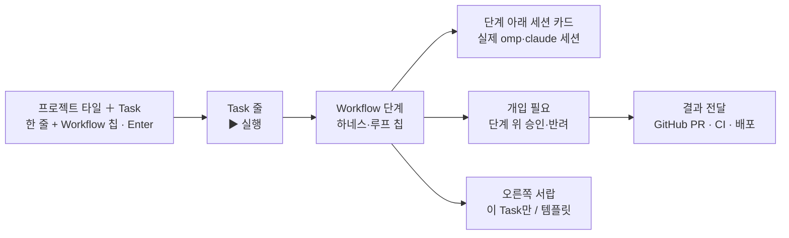
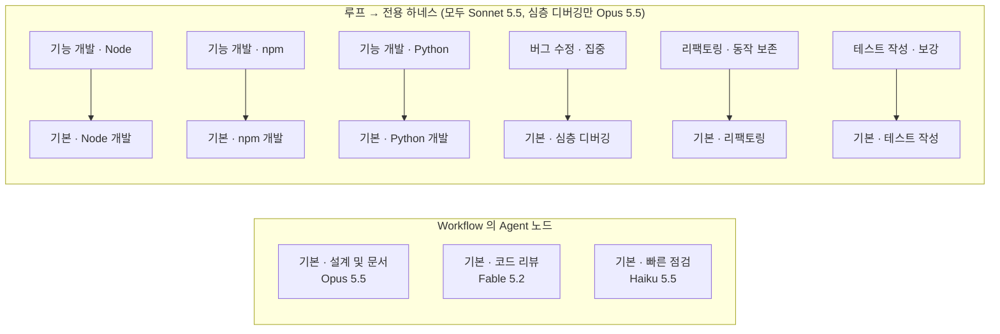
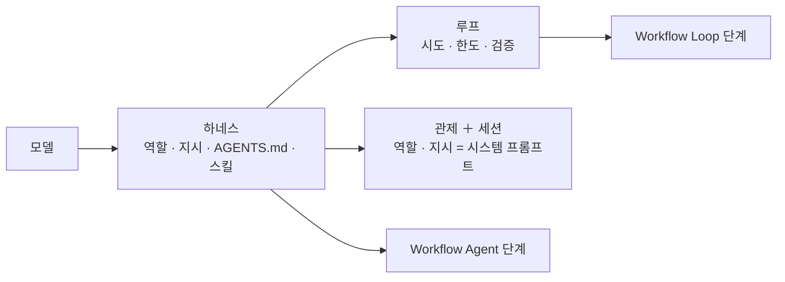

# Engineering: 에이전트 업무를 Workflow로 수행하기

Engineering은 에이전트(OMP·Claude Code)에게 개발 업무를 맡기고, 사람이 승인·개입하는 지점을 Workflow로 정해 두는 기능입니다. 관제(Live Map)와 **한 화면**이며, 웹 모드(`node server.js`)와 Windows 데스크톱 앱에서 똑같이 읽고 씁니다. 데스크톱 앱은 작업 폴더를 고를 때 폴더 선택 대화상자를 쓸 수 있는 것만 다르고, 웹 모드에서는 경로를 직접 입력합니다.

모든 편집과 실행은 **관제 벽**(프로젝트 타일 격자)에서 하고, **폼 화면과 탭은 없습니다.** 프로젝트마다 타일 하나이고, 타일 안은 Task 줄 > Workflow 단계(하네스·루프 칩) > 그 단계에서 실제로 돈 omp·claude 에이전트 카드와 서브에이전트 카드로 이어집니다(펼치기·접기·의미 확대 없음, 카드는 문장으로 지금 하는 일을 보여 줌). 단계·칩을 누르면 오른쪽 서랍에서 그 자리에서 고치고(자동 저장), Task ⋯ > **Workflow 편집**으로 단계를 넣고·옮기고·지웁니다(그 프로젝트 전체 화면에서 편집하고, 끝내면 벽으로 돌아옵니다). 하네스·루프·모델·Workflow 템플릿 목록은 맵 위 도구 막대의 **라이브러리** 서랍에 있습니다. 값은 그 자리에서 고칩니다(글자·숫자를 누르면 입력 한 칸이 열리고 Enter·포커스 이동 = 저장, Esc = 취소). 별도 Engineering 페이지는 없고, 예전 주소 `/engineering.html`은 맵(`/`)으로 넘어갑니다.

에이전트 프로필은 하네스로 합쳐졌습니다. 맵의 **＋ 세션**도 하네스를 고르며, 그 하네스의 역할·작업 지시가 세션의 시스템 프롬프트가 됩니다(아래 [하네스 · 루프의 연결](#하네스--루프의-연결)).

## 한 장으로 보는 흐름

| 어디서 | 하는 일 | 저장되는 것 |
|---|---|---|
| 프로젝트 타일 머리 | 상태(개입 필요·진행 중·쉬는 중), 세션 수·토큰·비용·주의 필요·CPU/RAM 한 줄, 지금 상태 한 줄, **＋ Task** 한 줄. 머리 끌기 = 순서, 모서리 끌기 = 크기, 두 번 누르기 = 프로젝트 전체 화면(최근 실행·예산 요약, 상태별 Task 수가 더 보임) | 프로젝트(폴더에서 자동), 예산, 타일 순서·크기(브라우저) |
| Task 줄 | 상태 색(Backlog·준비·진행 중·승인 대기·보류·완료), ▶ 실행, ⋯(Workflow 편집·자동 배치로 되돌리기·삭제). 카드를 누르면 서랍에서 본문·시간 한도·예산을 고칩니다. | Task |
| Workflow 단계 · 칩 | 단계(역할·지시·모델)와 하네스·루프(재시도·한도·검증 명령)를 서랍에서 고칩니다. 승인 대기 단계에는 승인·반려 버튼이 바로 붙습니다. | 정의 버전, Workflow 버전 |
| 에이전트·서브에이전트 카드 | 그 단계에서 돈 실제 세션(재시도 포함)의 메인 에이전트와 그 아래 들여 쌓은 서브에이전트(중첩 포함). 제목·`목표`·`지금 …`(끝나면 `결과 …`)·최근 한 일 3개를 문장으로 늘 보여 주고 카운터는 작은 보조 줄입니다. 배율과 상관없이 같은 내용입니다. 한 일 줄·카운터 = 서랍(diff·대화 자리), 두 번 누르기·**열기** = 전체 화면 | 세션 기록(JSONL, 읽기 전용) → 서버 활동 요약 |
| 라이브러리 서랍 | 하네스·루프·모델·Workflow 템플릿 목록과 새로 만들기·복제·삭제 | 정의, Workflow |

## 맵에서 고치기 (서랍)

단계 노드나 그 위 하네스·루프 칩을 누르면 오른쪽 서랍이 열립니다. 서랍은 입력을 멈추고 0.7초 뒤(또는 다른 칸으로 옮길 때) 자동 저장합니다.

- **단계**: 단계 이름, 지시(이 단계만의 추가 지시), 승인 단계라면 확인할 항목.
- **하네스**: 역할, 작업 지시, 모델(같은 범위의 모델 정의), 실행기.
- **루프**: 최대 시도, 시간·예산 한도, 검증 명령(허용 목록).
- **Task**(Task 카드를 누를 때): 본문(`완료 조건:` 줄), 시간 한도, 예산.

서랍 맨 위 **저장 범위**는 두 가지입니다.

| 범위 | 동작 |
|---|---|
| **이 Task만** (기본) | 이 Task가 쓰는 Workflow를 프로젝트 범위로 복사(이름 뒤 ` · Task <id 8자>`)하고, 고친 하네스·루프도 같은 범위로 복사해 그 복사본에 고정합니다. 이미 이 Task 전용 복사본이 있으면 새 버전만 씁니다. 다른 Task와 템플릿은 그대로입니다. |
| **템플릿** | 원래 정의·Workflow에 새 버전을 쓰고, 이 Task를 그 새 버전에 고정합니다. 이미 돈 실행은 시작한 버전을 그대로 씁니다. |

Task 전용 복사본을 쓰는 Task의 Workflow 칩에는 ✎ 표시가 붙고, 라이브러리 목록에서는 숨겨집니다(목록 위에 `Task 전용 사본 N개 숨김`).

## Workflow 편집 (맵 안)

Task ⋯ > **Workflow 편집**을 누르면 그 Task의 단계 줄만 편집 상태가 되고 나머지는 흐려집니다.

- 단계 사이의 **＋**: Agent 단계(하네스 고르기)·Loop 단계(루프 고르기)·승인 단계를 그 자리에 넣습니다.
- 단계를 **끌어** 순서를 바꿉니다. 놓는 자리가 표시됩니다.
- 단계 **⋯ > 지우기**: 단계를 지우고 앞뒤를 잇습니다. 지운 단계의 출력만 받던 입력은 함께 정리됩니다.
- Task 카드의 저장 범위(**이 Task만** / **템플릿**)를 따라 저장하고, **완료**·<kbd>Esc</kbd>로 끝냅니다.
- 실행 중인 Task의 Workflow는 고치지 않습니다(다음 실행부터 반영하려면 템플릿을 고칩니다). Task가 쓰는 Workflow는 라이브러리에서 지울 수 없습니다.

## Workflow

노드 종류: `Start`, `End`, `Agent`(하네스), `Loop`, `Command`(검증 명령), `Approval`(승인·반려), `Condition`, `Parallel`/`Join`, `Subgraph`(다른 Workflow 호출).

- 그래프에는 Start와 End가 각각 하나여야 합니다. 순환, 없는 포트, 잘못된 계약은 실행 계획 확인에서 거부합니다.
- 저장하면 새 버전이 됩니다. **과거 실행은 시작한 버전을 그대로 유지**합니다.
- 템플릿 내보내기·가져오기는 런타임 ID를 프로젝트 참조로 바꾸고, 자격 증명이 들어 있으면 거부합니다.

### 기본 제공 Workflow

템플릿 8종은 단계마다 맡는 하네스가 정해져 있습니다. 설계·문서는 **기본 · 설계 및 문서**, 리뷰는 **기본 · 코드 리뷰**, 분류는 **기본 · 빠른 점검**, 작업 및 검증은 루프(아래 표)가 맡습니다. 노드 지시문은 한국어로, 하네스의 역할과 이어지게 썼고, 승인 단계에는 확인할 항목을 번호로 적었습니다.

| 템플릿 | 단계 (괄호는 맡는 하네스·루프) | 처음 고르는 루프 |
|---|---|---|
| 신규 기능 개발 | 요구사항 및 계획(설계) → 설계 승인 → 작업 및 검증(루프) → 코드 리뷰(리뷰) → 최종 승인 | 기능 개발 · Node |
| 버그 수정 | 재현·원인 가설(설계) → 설계 승인 → 작업 및 검증(루프) → 코드 리뷰(리뷰) → 최종 승인 | 버그 수정 · 집중 |
| 리팩토링 | 구조 개선 계획(설계) → 설계 승인 → 작업 및 검증(루프) → 코드 리뷰(리뷰) → 최종 승인 | 리팩토링 · 동작 보존 |
| 테스트 작성 | 테스트 계획(설계) → 설계 승인 → 작업 및 검증(루프) → 코드 리뷰(리뷰) → 최종 승인 | 테스트 작성 · 보강 |
| 코드 리뷰 | 코드 리뷰(리뷰) → 최종 승인 (구현 파일 수정 없음) | 없음 |
| 기술 문서 작성 | 산출물 작성(설계) → 최종 승인 | 없음 |
| 릴리스 및 배포 | 릴리스 검증(`node --test`) → 릴리스 노트 작성(설계) → 최종 승인 | 없음 |
| 현장 장애 분석 | 관측 분류(빠른 점검) → 원인 분석 보고(설계) → 최종 승인 (읽기 전용 근거만 사용) | 없음 |

- **템플릿 만들기**: 템플릿은 처음 고를 때 그 프로젝트에 한 번 만들어집니다. 라이브러리 서랍의 **Workflow** 칸에서는 저장된 Workflow를 복제·삭제하고 **＋ 새 Workflow**로 신규 기능 개발 모양의 Workflow를 하나 만듭니다.
- **Task로 바로 실행**: 프로젝트 타일 **＋ Task** 줄의 Workflow 칩에서 템플릿을 고르면 그 템플릿의 Workflow가 프로젝트에 한 번 만들어지고(기본 하네스·루프, 위 표대로) 카드에 고정됩니다. 칩 위에 마우스를 올리면 단계마다 어떤 하네스·루프가 도는지 보입니다.
### 기본 하네스, 모델, 루프

**기본 구성 추가**는 모델 4개, 하네스 9개, 루프 6개를 개인 범위에 만듭니다. 이미 같은 이름의 정의가 있으면 건드리지 않으므로 이전에 만든 기본 정의는 바뀌지 않습니다.

**하네스는 역할마다 하나, 루프는 하네스마다 하나**입니다. 모든 루프가 같은 개발 하네스를 나눠 쓰지 않고, 언어와 목적에 맞는 전용 하네스가 붙습니다.

#### 하네스

각 하네스는 역할·작업 지시 외에 **AGENTS.md 규칙**과 **스킬**(작업 절차)을 함께 싣습니다. 실행기에는 프롬프트의 일부로 전달됩니다.

| 하네스 | 모델 | 맡는 일 | 스킬 |
|---|---|---|---|
| 기본 · 설계 및 문서 | Claude Opus 5.5 | 요구사항·계획·문서. 코드를 수정하지 않음 | `acceptance-criteria` |
| 기본 · 코드 리뷰 | Claude Fable 5.2 | 변경과 테스트 증거 검토. 구현 파일 수정 없음 | `review-checklist` |
| 기본 · 빠른 점검 | Claude Haiku 5.5 | 분류·요약·로그 점검처럼 가볍고 반복적인 일 | 없음 |
| 기본 · Node 개발 | Claude Sonnet 5.5 | `node:test` 규칙에 맞춘 구현과 테스트 | `tdd-cycle` |
| 기본 · npm 개발 | Claude Sonnet 5.5 | `package.json`·잠금 파일을 건드리지 않는 구현과 테스트 | `tdd-cycle` |
| 기본 · Python 개발 | Claude Sonnet 5.5 | `unittest`·표준 라이브러리 기준 구현과 테스트 | `tdd-cycle` |
| 기본 · 심층 디버깅 | Claude Opus 5.5 | 재현과 근본 원인을 먼저 확인하는 버그 수정 | `root-cause-analysis`, `tdd-cycle` |
| 기본 · 리팩토링 | Claude Sonnet 5.5 | 동작을 바꾸지 않는 구조 개선, 단계마다 검증 | `safe-refactor` |
| 기본 · 테스트 작성 | Claude Sonnet 5.5 | 운영 코드를 수정하지 않는 테스트 보강 | `test-design` |

- 설계와 리뷰는 서로 다른 모델을 씁니다. 같은 모델이 만든 계획을 같은 모델이 검토하지 않게 하려는 구성입니다.
- 개발 하네스 3종은 자기 루프의 검증 명령(`node --test`, `npm test`, `python3 -m unittest discover`)을 지시에 그대로 적고, 언어별 규칙을 AGENTS.md로 따로 둡니다. 모든 하네스에는 "패키지 설치·외부 다운로드·작업 폴더 밖 변경을 하지 않는다"는 규칙이 들어 있습니다. 실행이 사용자 PC에서 바로 돌기 때문입니다.
- 모델 선택 기준은 [Anthropic 모델 개요](https://platform.claude.com/docs/en/models/overview)의 용도 설명입니다(2026-11-26 확인). Fable 5.2는 까다로운 추론과 장시간 에이전트 작업용이라 가격이 가장 높으므로 리뷰처럼 출력이 짧은 단계에 두었습니다.
- 모델 ID는 `claude-fable-5-2`, `claude-opus-5-5`, `claude-sonnet-5-5`, `claude-haiku-5-5`입니다. 이전 모델(`claude-sonnet-4-6`, `claude-haiku-4-5-20251001`)로 저장한 정의도 계속 실행됩니다. Claude Mythos 5.2는 검증된 조직 전용이라 넣지 않았습니다.

#### 루프

루프는 하네스에 시도 횟수, 시간·예산 한도, 검증 명령을 붙인 것입니다. 한 번 시도할 때마다 에이전트가 작업하고, 검증 명령이 모두 성공하면 끝납니다. 실패하면 실패 출력을 다음 시도에 넘깁니다. 시도를 다 쓰거나 시간·예산이 바닥나면 `limit_exceeded`로 멈춥니다.

| 루프 | 전용 하네스 | 시도 | 시간 | 예산 | 검증 명령 |
|---|---|---|---|---|---|
| 기능 개발 · Node | 기본 · Node 개발 | 3 | 20분 | 6,000센트 | `node --test` |
| 기능 개발 · npm | 기본 · npm 개발 | 3 | 20분 | 6,000센트 | `npm test` |
| 기능 개발 · Python | 기본 · Python 개발 | 3 | 20분 | 6,000센트 | `python3 -m unittest discover` |
| 버그 수정 · 집중 | 기본 · 심층 디버깅 | 5 | 40분 | 15,000센트 | `node --test` |
| 리팩토링 · 동작 보존 | 기본 · 리팩토링 | 3 | 30분 | 8,000센트 | `node --test` |
| 테스트 작성 · 보강 | 기본 · 테스트 작성 | 3 | 20분 | 6,000센트 | `node --test` |

- **템플릿마다 맞는 루프를 처음 고릅니다.** 기본 제공 Workflow를 만들 때 신규 기능 개발은 기능 개발 · Node, 버그 수정은 버그 수정 · 집중, 리팩토링은 리팩토링 · 동작 보존, 테스트 작성은 테스트 작성 · 보강이 미리 선택됩니다. 직접 고른 루프는 템플릿을 바꿔도 유지되고, npm·Python 프로젝트는 목록에서 해당 루프로 바꿔 고르세요.
- 검증 명령은 실행기가 허용하는 `node --test`, `npm test`, `python3 -m unittest discover`(Windows에서 `python3`이 없으면 `python -m unittest discover`)뿐이며, 작업 폴더에서 이 PC의 명령으로 실행합니다. 버그 수정·리팩토링·테스트 작성 루프는 기본이 `node --test`이므로 다른 언어 프로젝트는 루프의 검증 명령을 바꿔 새 버전으로 저장하세요.
- **예산은 omp·claude가 보고한 사용 금액 기준의 상한입니다.** 각 단계가 끝난 뒤 CLI가 보고한 금액을 더해, 상한을 넘으면 다음 단계로 넘어가지 않고 `limit_exceeded`로 멈춥니다. 단계 하나가 도는 도중에는 미리 막지 않으므로, 한 단계가 상한보다 조금 더 쓸 수 있습니다. 구독 로그인으로 쓰는 CLI가 보고하는 금액은 청구 금액이 아닐 수 있습니다.
- Workflow 실행의 예산도 같은 방식이어서 개발 Task 카드의 기본값을 6,000센트($60.00)로 두었습니다. 15,000센트짜리 루프를 쓰려면 카드의 예산 숫자를 눌러 그 이상으로 올리세요.
- 입력이 10만 토큰을 넘는 호출은 거부됩니다. 읽을 자료를 작게 유지하세요.

#### 하네스 · 루프의 연결

- 같은 역할을 **하네스 하나**로 정의합니다. 자동 실행(Agent 단계·루프)과 대화형 세션(관제 **＋ 세션**) 모두 이 하네스를 씁니다. ＋ 세션에서 하네스를 고르면 역할·작업 지시가 시스템 프롬프트로 들어가고, 실행기와 모델은 하네스(와 연결된 모델 정의)를 따릅니다. 세션은 띄울 때의 설정을 계속 쓰므로 나중에 하네스를 고쳐도 이미 띄운 세션은 바뀌지 않습니다.
- 예전의 '에이전트 프로필'은 앱을 처음 열 때 하네스로 합쳐집니다(`server/engineering/harness-merge.js`). 같은 이름의 하네스가 있으면 그것을 쓰고, 없으면 프로필의 이름·역할·지시·모델로 개인 범위 하네스(필요하면 개인 모델 정의도)를 만듭니다. 프로필 노드를 쓰던 Workflow는 Agent 단계가 그 하네스를 직접 고정하도록 바뀌고(저장된 모든 버전), 프로필 정의는 지웁니다.

## 개발 Task

- **프로젝트는 등록하지 않습니다.** 벽의 타일은 등록된 프로젝트와, 세션이 열린 폴더(폴더별 묶음)입니다. 폴더 타일의 **＋ Task**를 쓰면 그 자리에서 프로젝트가 됩니다(이름 = 폴더 이름, 기준 브랜치 = 지금 브랜치, Git이 아니면 앱 데이터의 별도 Git 디렉터리를 씁니다). 세션 카드 메뉴의 **이 폴더에서 Task 만들기**도 같습니다.
- **Task 만들기**: 타일 머리의 **＋ Task**를 누르면 타일 본문 맨 위에 한 줄이 열립니다(쉬는 작은 타일은 그동안 커집니다). 할 일을 적고 **Workflow 칩**(템플릿 8종과 저장된 Workflow)을 고른 뒤 Enter로 만듭니다. 시간 한도(20분)·예산($60.00)은 기본값으로 시작합니다. 위쪽 **＋ 새 실행**은 지금(또는 가장 최근) 프로젝트의 ＋ Task 줄을 열며, 이때 Enter는 Task를 만들고 곧바로 실행합니다.
- **Task 고치기**: Task 카드를 누르면 서랍에서 본문·시간 한도·예산을 고칩니다(자동 저장). `완료 조건:`으로 시작하는 줄을 쓰면 그 줄(과 그 아래)을 기본 완료 조건 대신 씁니다. 비우면 기본값으로 돌아갑니다.
- **실행(▶)**: Task 카드의 ▶는 카드 글(제목·본문)과 고른 Workflow로 프로젝트 폴더에서 실행합니다. 상태 색이 준비 → 진행 중 → 승인 대기 → 완료/보류로 바뀌고, 각 단계 아래에 그 단계에서 돈 세션 카드가 붙습니다.
- **상태와 줄 순서**: 칸반 칸 대신 상태 색입니다. 줄은 개입 필요(승인 대기·보류) → 진행 중 → 대기(Backlog·준비) → 완료 순서이고, 같은 묶음 안에서는 최근에 바뀐 Task가 위입니다. Backlog Task의 단계는 아직 돌지 않아 흐리게 보입니다. 완료된 Task는 접지 않고 단계·에이전트까지 흐리게 그립니다(마우스를 올리면 또렷해집니다).
- **요약 한 줄**: 프로젝트 전체 화면(타일 머리 두 번 누르기)의 머리에 `최근 7일 실행 12건 · $34.00 / 예산 $100.00`처럼 보입니다. 기간이나 예산 금액을 누르면 그 자리에서 고치고, 예산을 비우면 제한이 없어집니다.
- **실행 환경**은 위쪽 막대의 점(`● omp · claude`)으로 봅니다. CLI를 찾지 못하면 빨간 점과 함께 그 이름을 지운 줄로 보여 주고, 점을 누르면 다시 확인합니다.

## 실행을 따라가고 개입하기

1. Task 카드의 **▶**(또는 위쪽 **＋ 새 실행** → 한 줄 → Enter)로 시작합니다. `omp`·`claude` CLI를 찾지 못했으면 시작 전에 알려 줍니다.
2. 실행 중인 단계는 테두리가 빛나고, 단계 아래에 그 단계의 세션 카드(재시도마다 하나)가 선으로 이어집니다. 세션과 단계는 실행기가 보고한 세션 id로 잇습니다(`server/engineering/task-map.js`). 기록이 이 PC에 없는 세션은 점선 한 줄(`이 PC 기록(지금 기간)에 없음`)로 남습니다. 끝난 Task는 접지 않고 조금 흐리게 그립니다.
3. **개입**: 승인 대기 단계 노드 위의 **승인**·**반려**(반려는 사유 필수)로 바로 처리합니다. 단계를 누르면 서랍에서 확인할 항목과 메모를 함께 봅니다. 위쪽 **개입 필요 N**(<kbd>Alt</kbd>+<kbd>I</kbd>)을 누르면 기다리는 단계로 화면이 이동합니다.
4. 세션 카드를 두 번 누르거나 **열기**를 누르면 그 세션이 전체 화면(대화·터미널·파일)으로 열립니다. <kbd>Esc</kbd> 또는 **← 맵으로**는 같은 맵 위치로 돌아갑니다.
5. 완료된 실행의 결과 전달(GitHub PR·CI·배포)은 서버 API(`/api/engineering/*`)로 그대로 이어집니다.

## 안전장치

| 영역 | 동작 |
|---|---|
| 실행 위치 | 에이전트(이 PC에 설치된 `omp`·`claude` CLI)와 허용 목록의 검증 명령은 **이 PC에서, 고른 작업 폴더에 바로** 실행합니다. 터미널에서 omp나 claude를 직접 실행하는 것과 같아서 내 계정 권한으로 파일을 바꾸고 네트워크도 그대로 씁니다. 로그인·모델 설정은 각 CLI에 이미 해 둔 것을 씁니다. `omp`나 `claude`를 PATH에서 찾지 못하면 시작하지 않고 이유를 알려 줍니다. |
| 작업 공간 | 복사본(worktree)을 만들지 않고 작업 폴더에서 바로 실행하므로, 결과는 실행이 끝나면 이미 그 폴더에 있습니다. 병렬 분기도 같은 폴더에서 차례로 실행합니다. Git 저장소가 아닌 폴더도 쓸 수 있습니다. 이때는 앱 데이터의 별도 Git 디렉터리(`shadow/`)에 실행 전 스냅숏을 남겨 변경 검토에 쓰고, 사용자 폴더에는 `.git`을 만들지 않습니다. GitHub PR·CI 전달은 원격(origin)이 있는 Git 폴더에서만 되며, 작업 폴더에서 변경을 커밋하고 브랜치를 푸시한 뒤 승인합니다. |
| 결과 불확실 | 결과가 불확실한 노드는 다시 실행하지 않고 사용자 확인을 기다립니다. 앱을 다시 시작하면 완료된 시도는 건너뜁니다. |
| 예산·시간 | Loop와 Workflow에 시간·예산 한도가 있고, 초과하면 `limit_exceeded`로 멈춥니다. 활성 Loop를 취소하면 추가 시도를 시작하지 않습니다. |
| 비밀 | API 키와 토큰 형태의 문자열은 기록에서 마스킹합니다. 앱은 API 키나 로그인을 받지 않습니다(각 CLI의 설정을 씁니다). |
| 서버 경계 | 서버는 `127.0.0.1`에만 열립니다. `Host`가 `127.0.0.1:<포트>`·`localhost:<포트>`가 아니면(DNS rebinding) 거부하고, 상태를 바꾸는 요청은 같은 출처(`Origin`이 없거나 이 서버)·JSON 본문만 받습니다. `/api/engineering/*`와 운영 API는 서버를 시작할 때마다 새로 만드는 토큰이 있어야 하며, 토큰은 같은 출처 화면(`/`)에만 심겨 가므로 다른 사이트는 읽을 수 없습니다. 데스크톱 앱의 렌더러는 샌드박스에서 돌고, 폴더 선택 대화상자 말고는 IPC를 쓰지 않습니다. |

## 처음 쓰기

1. 위쪽 막대의 실행 환경 점이 `● omp · claude`로 초록인지 봅니다(빨간 점이면 CLI를 설치한 뒤 점을 눌러 다시 확인). 로그인·API 키는 각 CLI에 해 둔 설정을 그대로 씁니다.
2. 벽에서 작업할 폴더의 타일(세션이 열린 폴더)이나 등록된 프로젝트 타일을 찾습니다. 아직 없으면 세션 카드 메뉴의 **이 폴더에서 Task 만들기** 또는 **＋ 새 실행**을 씁니다.
3. 타일 머리의 **＋ Task**를 눌러 할 일을 한 줄로 적고 Workflow 칩(예: 버그 수정)을 고른 뒤 Enter를 누릅니다. 템플릿을 처음 쓰면 기본 모델·하네스·루프(개인 범위)와 그 템플릿의 Workflow가 함께 만들어집니다.
4. 필요하면 Task 카드를 눌러 서랍에서 본문·`완료 조건:`·시간 한도·예산을 고치고 **▶**를 누릅니다. 단계 아래 세션 카드로 진행을 따라가고, 승인은 그 단계 위에서 합니다.
5. 단계·하네스를 바꾸려면 단계나 칩을 눌러 서랍에서 고칩니다(기본은 **이 Task만**).

V2에서 쓰던 데이터는 앱이 처음 실행할 때 가져옵니다.
