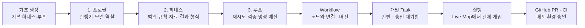
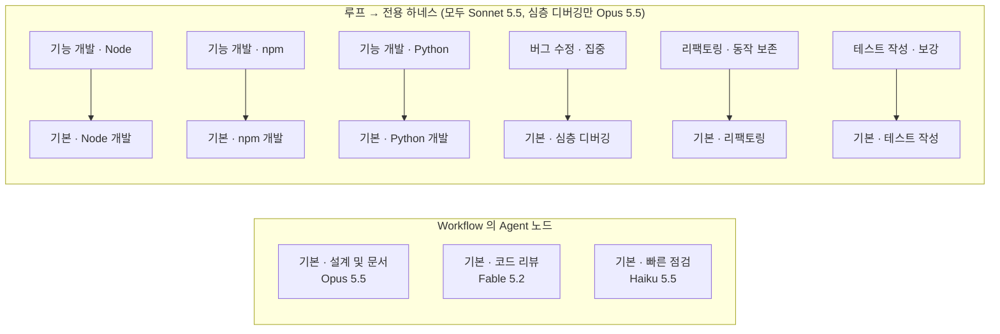
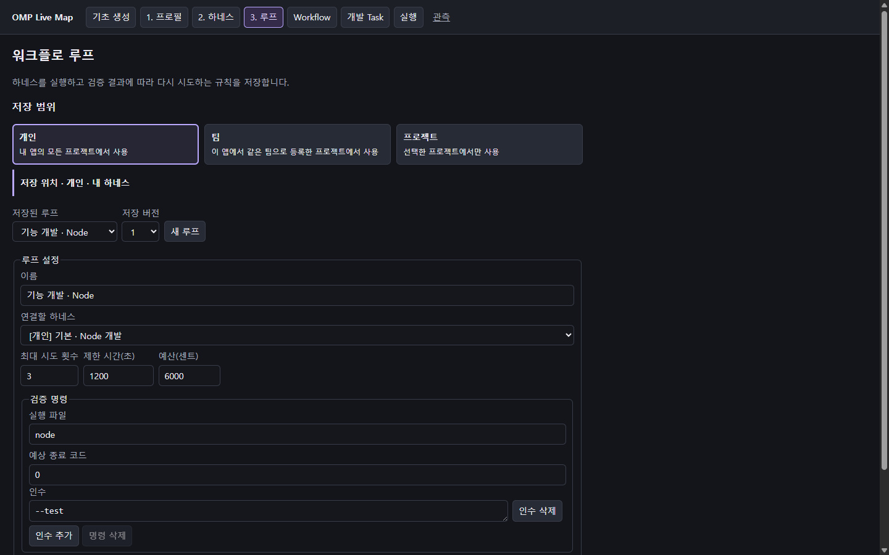
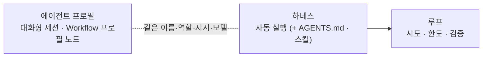
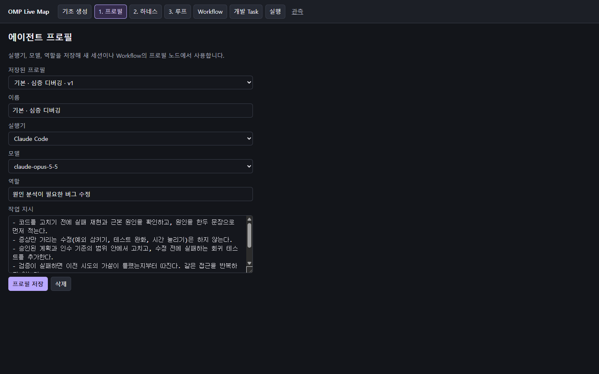
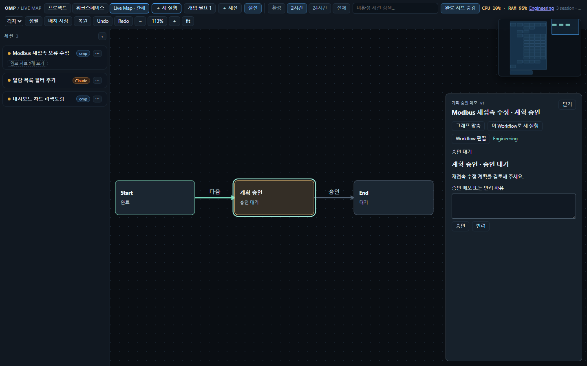

# Engineering: 에이전트 업무를 Workflow로 수행하기

Engineering은 에이전트(OMP·Claude Code)에게 개발 업무를 맡기고, 사람이 승인·개입하는 지점을 Workflow로 정해 두는 기능입니다. **Windows 데스크톱 앱에서만** 데이터를 읽고 씁니다. 웹 모드에서는 화면만 열리고 `/api/engineering/*`가 403입니다.

## 한 장으로 보는 흐름

| 단계 | 하는 일 | 저장되는 것 |
|---|---|---|
| 기초 생성 | 프로필·하네스·루프를 만드는 시작 화면. **기본 하네스·루프 만들기**로 에이전트 프로필, 설계·리뷰·개발 하네스, 테스트 루프를 한 번에 준비합니다. | 개인 범위 정의(프로젝트 없이도 가능) |
| 1. 프로필 | 실행기(OMP / Claude Code), 모델, 역할, 작업 지시를 버전으로 저장합니다. 새 세션과 Workflow 노드에서 씁니다. | 프로필 버전 |
| 2. 하네스 | 저장 범위(개인·팀·프로젝트), 역할 템플릿, 프로젝트 규칙(AGENTS.md), 읽을 자료, 스킬, 결과 형식, MCP·Hooks 초안을 편집합니다. | 하네스 버전 |
| 3. 루프 | 하네스에 재시도 횟수, 시간 제한, 예산, 검증 명령을 붙입니다. | 루프 버전 |
| Workflow | 노드와 연결로 업무 흐름을 그립니다. 실행 계획 확인 후 새 버전으로 저장합니다. | Workflow 버전, 템플릿 |
| 개발 Task | 업무를 칸반으로 관리하고 Workflow 버전과 한도를 고정합니다. | Task, 단계 설정 |
| 실행 | Live Map에서 시작·진행 확인·승인·재시도·수정 요청을 합니다. | 실행 기록, 산출물, 감사 이벤트 |

## 하네스 편집

- **저장 범위**: 개인(내 앱의 모든 프로젝트), 팀(같은 팀으로 등록한 프로젝트), 프로젝트(선택한 프로젝트만).
- **역할 템플릿**: 개발자, 코드 리뷰어, 문서 작성자, 사용자 정의.
- **읽을 자료**: 저장소 파일 경로와 Workflow 입력 이름. 저장소 자료는 추적되는 커밋 내용으로 고정해 미리 확인합니다.
- **결과 형식**: 자유 형식, JSON 객체, JSON 객체 목록. 필수 필드를 정하면 결과 파일을 검증합니다.
- **실제 적용값 미리보기**: 저장 전에 실행기에 전달될 프롬프트 순서와 설정을 확인합니다.
- **동일 입력으로 비교 실행**: 기준 버전과 초안을 같은 커밋·같은 입력으로 각자 격리된 worktree에서 실행해 비교합니다. 예산은 함께 소비합니다.

## Workflow

노드 종류: `Start`, `End`, `Agent`(프로필 또는 하네스), `Loop`, `Command`(검증 명령), `Approval`(승인·반려), `Condition`, `Parallel`/`Join`, `Subgraph`(다른 Workflow 호출), `Profile`(Agent에 연결하는 프로필 노드).

- 그래프에는 Start와 End가 각각 하나여야 합니다. 순환, 없는 포트, 잘못된 계약은 실행 계획 확인에서 거부합니다.
- 저장하면 새 버전이 됩니다. **과거 실행은 시작한 버전을 그대로 유지**합니다.
- 템플릿 내보내기·가져오기는 런타임 ID를 프로젝트 참조로 바꾸고, 자격 증명이 들어 있으면 거부합니다.

### 기본 제공 Workflow

| 이름 | 단계 |
|---|---|
| 신규 기능 개발 | 요구사항·계획 → 설계 승인 → 작업 및 검증(Loop) → 코드 리뷰 → 최종 승인 |
| 버그 수정 | 위와 같은 단계. 재현 테스트를 먼저 추가합니다. |
| 리팩토링 | 위와 같은 단계. 외부 동작을 유지합니다. |
| 테스트 작성 | 위와 같은 단계. 운영 코드는 바꾸지 않습니다. |
| 코드 리뷰 | 코드 리뷰 → 최종 승인 (구현 파일 수정 없음) |
| 기술 문서 작성 | 산출물 작성 → 최종 승인 |
| 릴리스 및 배포 | 릴리스 검증(`node --test`) → 산출물 작성 → 최종 승인 |
| 현장 장애 분석 | 산출물 작성 → 최종 승인 (읽기 전용 근거만 사용) |

### 기본 프로필, 하네스, 모델, 루프

**기본 하네스·루프 만들기**는 모델 4개, 에이전트 프로필 9개, 하네스 9개, 루프 6개를 만듭니다(모델·하네스·루프는 개인 범위, 프로필은 범위가 없는 전역 정의). 이미 같은 이름의 정의가 있으면 건드리지 않으므로 이전에 만든 기본 정의는 바뀌지 않습니다.

**하네스는 역할마다 하나, 루프는 하네스마다 하나**입니다. 모든 루프가 같은 개발 하네스를 나눠 쓰지 않고, 언어와 목적에 맞는 전용 하네스가 붙습니다.

#### 하네스

각 하네스는 역할·작업 지시 외에 **AGENTS.md 규칙**과 **스킬**(작업 절차)을 함께 싣습니다. 실행기에는 프롬프트의 일부로 전달됩니다.

| 하네스 | 모델 | 맡는 일 | 스킬 |
|---|---|---|---|
| 기본 · 설계 및 문서 | Claude Opus 5.5 | 요구사항·계획·문서. 코드를 수정하지 않음 | `acceptance-criteria` |
| 기본 · 코드 리뷰 | Claude Fable 5.2 | 변경과 테스트 증거 검토. 구현 파일 수정 없음 | `review-checklist` |
| 기본 · 빠른 점검 | Claude Haiku 5.5 | 분류·요약·로그 점검처럼 가볍고 반복적인 일 | 없음 |
| 기본 · Node 개발 | Claude Sonnet 5.5 | `node:test` 규칙에 맞춘 구현과 테스트 | `tdd-cycle` |
| 기본 · npm 개발 | Claude Sonnet 5.5 | `package.json`·잠금 파일을 건드리지 않는 구현과 테스트 | `tdd-cycle` |
| 기본 · Python 개발 | Claude Sonnet 5.5 | `unittest`·표준 라이브러리 기준 구현과 테스트 | `tdd-cycle` |
| 기본 · 심층 디버깅 | Claude Opus 5.5 | 재현과 근본 원인을 먼저 확인하는 버그 수정 | `root-cause-analysis`, `tdd-cycle` |
| 기본 · 리팩토링 | Claude Sonnet 5.5 | 동작을 바꾸지 않는 구조 개선, 단계마다 검증 | `safe-refactor` |
| 기본 · 테스트 작성 | Claude Sonnet 5.5 | 운영 코드를 수정하지 않는 테스트 보강 | `test-design` |

- 설계와 리뷰는 서로 다른 모델을 씁니다. 같은 모델이 만든 계획을 같은 모델이 검토하지 않게 하려는 구성입니다.
- 개발 하네스 3종은 자기 루프의 검증 명령(`node --test`, `npm test`, `python3 -m unittest discover`)을 지시에 그대로 적고, 언어별 규칙을 AGENTS.md로 따로 둡니다. 모든 하네스에는 "실행 환경에는 네트워크가 없다"는 규칙이 들어 있어 패키지 설치를 시도하며 시도를 낭비하지 않게 합니다.
- 모델 선택 기준은 [Anthropic 모델 개요](https://platform.claude.com/docs/en/models/overview)의 용도 설명입니다(2026-11-26 확인). Fable 5.2는 까다로운 추론과 장시간 에이전트 작업용이라 가격이 가장 높으므로 리뷰처럼 출력이 짧은 단계에 두었습니다.
- 모델 ID는 `claude-fable-5-2`, `claude-opus-5-5`, `claude-sonnet-5-5`, `claude-haiku-5-5`입니다. 이전 모델(`claude-sonnet-4-6`, `claude-haiku-4-5-20251001`)로 저장한 정의도 계속 실행됩니다. Claude Mythos 5.2는 검증된 조직 전용이라 넣지 않았습니다.

#### 루프

루프는 하네스에 시도 횟수, 시간·예산 한도, 검증 명령을 붙인 것입니다. 한 번 시도할 때마다 에이전트가 작업하고, 검증 명령이 모두 성공하면 끝납니다. 실패하면 실패 출력을 다음 시도에 넘깁니다. 시도를 다 쓰거나 시간·예산이 바닥나면 `limit_exceeded`로 멈춥니다.

| 루프 | 전용 하네스 | 시도 | 시간 | 예산 | 검증 명령 |
|---|---|---|---|---|---|
| 기능 개발 · Node | 기본 · Node 개발 | 3 | 20분 | 6,000센트 | `node --test` |
| 기능 개발 · npm | 기본 · npm 개발 | 3 | 20분 | 6,000센트 | `npm test` |
| 기능 개발 · Python | 기본 · Python 개발 | 3 | 20분 | 6,000센트 | `python3 -m unittest discover` |
| 버그 수정 · 집중 | 기본 · 심층 디버깅 | 5 | 40분 | 15,000센트 | `node --test` |
| 리팩토링 · 동작 보존 | 기본 · 리팩토링 | 3 | 30분 | 8,000센트 | `node --test` |
| 테스트 작성 · 보강 | 기본 · 테스트 작성 | 3 | 20분 | 6,000센트 | `node --test` |

- **템플릿마다 맞는 루프를 처음 고릅니다.** 기본 제공 Workflow를 만들 때 신규 기능 개발은 기능 개발 · Node, 버그 수정은 버그 수정 · 집중, 리팩토링은 리팩토링 · 동작 보존, 테스트 작성은 테스트 작성 · 보강이 미리 선택됩니다. 직접 고른 루프는 템플릿을 바꿔도 유지되고, npm·Python 프로젝트는 목록에서 해당 루프로 바꿔 고르세요.
- 검증 명령은 컨테이너가 허용하는 `node --test`, `npm test`, `python3 -m unittest discover` 세 가지뿐입니다. 버그 수정·리팩토링·테스트 작성 루프는 기본이 `node --test`이므로 다른 언어 프로젝트는 루프의 검증 명령을 바꿔 새 버전으로 저장하세요.
- **예산은 실제 비용이 아니라 호출 전에 예약하는 상한입니다.** 모델을 부르기 전에 입력 토큰 수와 출력 한도로 보수적으로 계산한 금액을 예산에서 미리 뺍니다(출력은 최대 8,192토큰으로 제한). 컨텍스트 20K 토큰짜리 호출 한 번이 약 228센트를 예약하므로, 예산 100센트로는 호출을 한 번도 못 합니다. 6,000센트는 시도당 약 26회, 15,000센트는 약 65회 호출을 받아 줍니다. 실제 비용은 보통 이보다 훨씬 적고 시도 기록에 따로 남습니다.
- Workflow 실행의 예산도 같은 방식이어서 개발 Task와 **새 실행**의 기본값을 6,000센트로 두었습니다. 15,000센트짜리 루프를 쓰려면 실행 예산을 그 이상으로 올리세요.
- 입력이 10만 토큰을 넘는 호출은 거부됩니다. 읽을 자료를 작게 유지하세요.

#### 프로필 · 하네스 · 루프의 연결

- 프로필과 하네스는 **데이터로 서로를 가리키지 않습니다.** 프로필은 별도 저장소에 있고, 하네스는 Engineering 데이터베이스에 있습니다. 대신 기본 정의는 한 곳(`server/engineering/default-definitions.js`)에서 만들어 두 저장소에 같은 내용으로 넣고, 테스트가 이름·역할·지시·모델이 일치하는지 확인합니다. AGENTS.md 규칙과 스킬은 하네스에만 들어갑니다.
- 루프는 하네스만 가리키므로 프로필과는 하네스를 거쳐 이름으로 이어집니다.
- 프로필이 하는 일: 관제의 **새 세션**에서 고르면 역할과 작업 지시가 시스템 프롬프트로 들어가고, Workflow에서는 프로필 노드를 Agent 노드에 연결해 하네스 대신 쓸 수 있습니다. 하네스는 읽을 자료·스킬·결과 형식까지 정하고 루프와 묶입니다.
- 이미 같은 이름의 프로필이 있으면 다시 만들지 않고, 고친 내용도 덮어쓰지 않습니다. 한쪽을 고치면 다른 쪽은 자동으로 바뀌지 않으니 같이 고쳐 주세요.
## 개발 Task와 승인 대기함

- 칸반 단계: Backlog · 준비 · 진행 중 · 승인 대기 · 보류 · 완료. 단계 이름은 프로젝트별로 바꿀 수 있습니다.
- Task는 Workflow 버전, 실행 시간 한도(기본 20분), 실행 예산(기본 6,000센트)을 고정해 실행합니다.
- **승인 대기함**에 모든 승인 요청이 모입니다. 프로젝트 실행 지표(최근 7·30·90일)도 같은 화면에서 봅니다.
- 프로젝트별 예산 상한은 V2 Loop와 V3 Workflow 실행이 함께 사용합니다.

## Live Map에서 실행하고 개입하기

1. Live Map 상단 **새 실행**에서 프로젝트, 템플릿, 작업 목표, 완료 조건을 입력해 시작합니다. 준비가 필요한 하네스나 런타임은 시작 전에 알려 줍니다.
2. 실행 중인 Workflow가 세션 카드와 같은 캔버스에 노드와 연결선으로 나타납니다. 상태가 갱신돼도 카드 배치·확대·선택이 유지됩니다.
3. **개입 필요**에 승인 대기·실패·확인 필요 실행이 모입니다. 노드를 눌러 결과, 산출물, 시도 정보를 확인합니다.
4. 실패한 검증은 **재검증**(현재 작업 공간 사용) 또는 **구현 보완 요청**(실패 근거 전달)으로 되돌립니다. 승인과 반려는 메모와 함께 남습니다.
5. 같은 캔버스에서 편집 모드로 바꿔 노드·연결을 고치고 새 버전으로 저장합니다. 실행을 닫으면 이전 캔버스 위치로 돌아갑니다.
6. 완료된 실행은 **GitHub PR 및 CI** 단계로 이어집니다. 브랜치 승인 → PR 생성 → CI 확인 → 릴리스 승인, 배포 환경(`test`·`staging`) 전달을 같은 화면에서 처리합니다.

설계 문서는 [Workflow를 Live Map에서 실행·관제·편집](../workflow-canvas-tasks.md), 하네스 편집 개발 기록은 [하네스 편집 개발 기록](../harness-editor-progress.md)에 있습니다.

## 안전장치

| 영역 | 동작 |
|---|---|
| 격리 | 에이전트와 허용 목록의 검증 명령은 로컬 Linux Docker 엔진의 컨테이너에서 실행합니다. 컨테이너는 네트워크가 없고, 파일시스템이 읽기 전용이며, 모든 capability를 제거하고, 메모리 2GB·CPU 2개로 제한합니다. 모델 호출은 앱이 중계하는 로컬 게이트웨이로만 나가므로 실제 API 키는 컨테이너에 들어가지 않습니다. 실행 환경이 준비되지 않으면 시작하지 않고 이유를 알려 줍니다. |
| 작업 공간 | 실행마다 별도 Git worktree를 씁니다. 병렬 분기도 서로 다른 worktree에서 돌고 Join 전에 산출물을 게시합니다. 더럽혀진 작업 트리는 보존합니다. |
| 결과 불확실 | 결과가 불확실한 노드는 다시 실행하지 않고 사용자 확인을 기다립니다. 앱을 다시 시작하면 완료된 시도는 건너뜁니다. |
| 예산·시간 | Loop와 Workflow에 시간·예산 한도가 있고, 초과하면 `limit_exceeded`로 멈춥니다. 활성 Loop를 취소하면 추가 시도를 시작하지 않습니다. |
| 비밀 | API 키와 토큰 형태의 문자열은 기록에서 마스킹합니다. 키는 Windows 사용자 비밀 저장소(DPAPI)에 저장하고 파일에는 평문이 남지 않습니다. |
| 앱 경계 | 렌더러는 샌드박스에서 돌고, `/api/engineering/*`는 앱이 만든 토큰이 있는 요청만 받습니다. |

## 처음 쓰기

1. 앱에서 **Engineering**을 엽니다.
2. **실행 환경**을 열어 **실행 환경 준비**를 누르고, Anthropic API 키를 저장하거나 **Claude Console 로그인**을 합니다. Docker Desktop(Linux 엔진)이 필요합니다.
3. **기초 생성**에서 **기본 하네스·루프 만들기**를 누릅니다.
4. Workflow 화면에서 **프로젝트 설정**으로 로컬 Git 저장소를 등록합니다. 프로젝트 선택은 Workflow·개발 Task·실행 화면에서만 보입니다.
5. **기본 제공 Workflow**에서 템플릿을 고르고 **새 실행**을 누릅니다.

V2에서 쓰던 데이터는 앱이 처음 실행할 때 가져옵니다.
