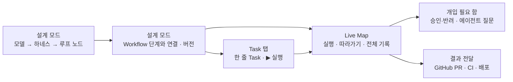
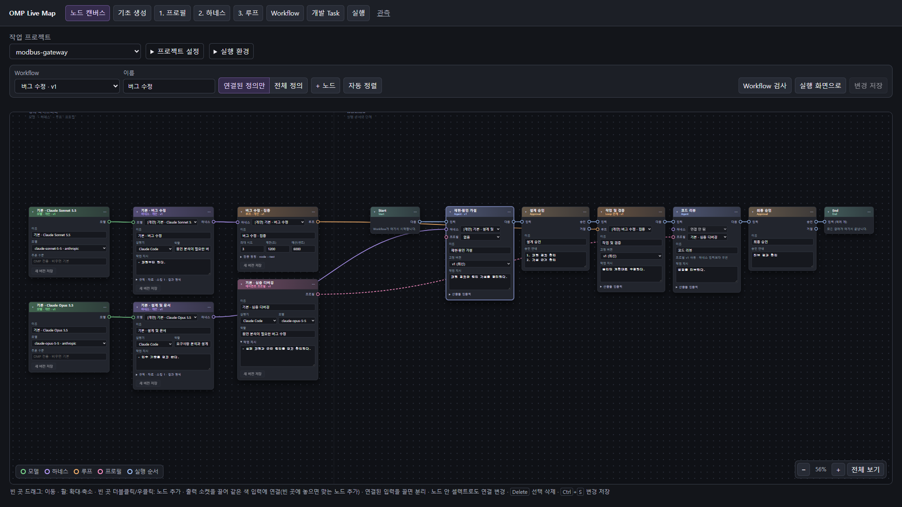
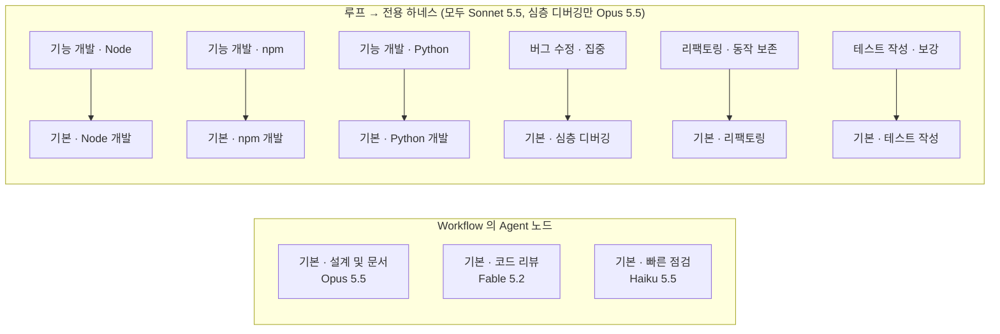
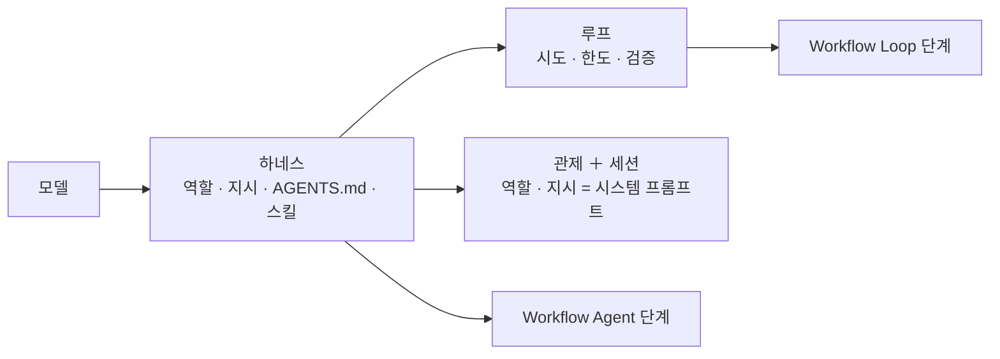

# Engineering: 에이전트 업무를 Workflow로 수행하기

Engineering은 에이전트(OMP·Claude Code)에게 개발 업무를 맡기고, 사람이 승인·개입하는 지점을 Workflow로 정해 두는 기능입니다. 관제(Live Map)와 **한 화면**이며, 웹 모드(`node server.js`)와 Windows 데스크톱 앱에서 똑같이 읽고 씁니다. 데스크톱 앱은 작업 폴더를 고를 때 폴더 선택 대화상자를 쓸 수 있는 것만 다르고, 웹 모드에서는 경로를 직접 입력합니다.

모든 편집과 실행은 **관제 화면 한 곳**에서 하고, **폼 화면은 없습니다.** 위쪽 모드에서 **설계 · 노드 캔버스**(<kbd>Alt</kbd>+<kbd>4</kbd>)로 모델 → 하네스 → 루프 → Workflow를 노드로 편집하고, **Task** 탭(<kbd>Alt</kbd>+<kbd>5</kbd>)의 칸반에서 한 줄로 업무를 만들어 ▶로 실행하며, **Live Map · 관제**(<kbd>Alt</kbd>+<kbd>3</kbd>)에서 실행을 보고 개입합니다. 값은 그 자리에서 고칩니다(글자·숫자를 누르면 입력 한 칸이 열리고 Enter·포커스 이동 = 저장, Esc = 취소). 별도 Engineering 페이지는 없고, 예전 주소 `/engineering.html`은 Task 탭으로 넘어갑니다.

에이전트 프로필은 하네스로 합쳐졌습니다. 관제의 **＋ 세션**도 하네스를 고르며, 그 하네스의 역할·작업 지시가 세션의 시스템 프롬프트가 됩니다(아래 [하네스 · 루프의 연결](#하네스--루프의-연결)).

## 한 장으로 보는 흐름

| 어디서 | 하는 일 | 저장되는 것 |
|---|---|---|
| 설계 모드 · 정의 노드 | 모델, 하네스(역할·지시·AGENTS.md·자료·스킬·결과 형식·MCP/Hooks 초안), 루프(재시도·한도·검증 명령)를 노드 안에서 고칩니다. 노드 메뉴 **상세**에서 버전 기록·실제 적용값·사용 중 Workflow·비교 실행을 봅니다. | 정의 버전 |
| 설계 모드 · Workflow | 단계 노드와 연결로 업무 흐름을 그리고 검사 후 새 버전으로 저장합니다. **Workflow ⋯**에서 기본 8종 추가·JSON 내보내기·가져오기. | Workflow 버전, 템플릿 |
| Task 탭 · 개발 Task | Backlog ＋ 한 줄(글 + Workflow 칩)로 카드를 만들고 ▶로 실행합니다(실행은 맵 탭에서 열림). 칸 이름·순서, 카드 본문·시간 한도·예산, 요약 줄의 기간·프로젝트 예산을 그 자리에서 고칩니다. | Task, 칸, 프로젝트(폴더에서 자동), 예산 |
| Live Map | 시작·진행 확인·승인·재시도·수정 요청·일시정지·취소·결과 전달을 합니다. | 실행 기록, 단계별 수행 내역, 산출물, 감사 이벤트 |

## 설계 모드 (노드 캔버스)

관제 화면 위쪽 모드에서 **설계 · 노드 캔버스**를 누릅니다(<kbd>Alt</kbd>+<kbd>4</kbd>). ComfyUI처럼 노드를 선으로 잇고, 노드 안의 셀렉트·입력칸으로 모델, 하네스, 루프, Workflow 단계를 한 곳에서 편집합니다. 설계 탭은 캔버스(와 도구 모음)뿐입니다. 관제(Live Map)로 갔다 와도 편집 중인 캔버스와 프로젝트 선택은 그대로입니다. 작업 폴더는 캔버스 위 **작업 폴더**에서 고릅니다(Task 탭에서 폴더를 고르면 생깁니다).

- **첫 화면**: Workflow를 열지 않으면 정의를 접어 목록처럼 보여 줍니다(왼쪽부터 모델 → 하네스 → 루프). Workflow를 열면 그 Workflow에 연결된 노드를 70% 이상으로 맞추고 나머지는 접습니다. **전체 보기**는 배율과 관계없이 모두 넣습니다.

| 소켓 색 | 연결 | 의미 |
|---|---|---|
| 초록 | 모델 → 하네스 | 하네스가 쓸 모델. **같은 저장 범위**끼리만 연결됩니다. |
| 보라 | 하네스 → 루프, 하네스 → Agent 단계 | 루프가 실행할 하네스, Agent 단계가 쓸 하네스(버전 고정). |
| 주황 | 루프 → Loop 단계 | Loop 단계가 쓸 루프(버전 고정). |
| 하늘 | Workflow 단계 → 단계 | 실행 순서. 출력(다음·참/거짓·승인/거절)마다 다음 단계 하나를 잇습니다. |

- **연결**: 출력 소켓을 끌어 같은 색 입력 소켓(또는 노드 본문)에 놓습니다. 노드 안 입력 줄의 셀렉트로 골라도 같은 연결이 됩니다. 빈 곳에 놓으면 그 소켓에 맞는 노드만 고르는 메뉴가 열리고, 고른 노드에 바로 연결됩니다.
- **분리**: 연결된 입력 소켓을 끌면 선이 떼어져 다른 곳에 꼽을 수 있습니다. 선을 한 번 누르면 선택(<kbd>Delete</kbd>로 끊기), 빠르게 두 번 누르면 바로 끊습니다.
- **추가**: 빈 곳 더블클릭·우클릭 또는 **+ 노드**. 검색어를 입력하고 Enter로 첫 항목을 넣습니다. 하네스는 개발자·코드 리뷰어·문서 작성자 템플릿으로 시작할 수 있고, 새 정의 노드는 노드 안 **저장 범위** 셀렉트로 개인·프로젝트를 고릅니다.
- **되돌리기**: 저장하기 전의 캔버스 편집(노드 추가·삭제, 연결, 이동, 값 변경)은 <kbd>Ctrl</kbd>+<kbd>Z</kbd>(다시 실행 <kbd>Ctrl</kbd>+<kbd>Shift</kbd>+<kbd>Z</kbd>) 또는 도구 모음의 ↶ ↷로 되돌립니다. 입력칸 안에서는 글자 되돌리기가 먼저입니다. 서버에서 지운 정의와 다른 Workflow·프로젝트로 바꾸기 전의 편집은 되돌릴 수 없습니다.
- **저장**: 노드 아래 **저장 / 새 버전 저장**, 또는 위의 **변경 저장 (n)**·<kbd>Ctrl</kbd>+<kbd>S</kbd>로 바뀐 것을 모두 저장합니다. 모델 → 하네스 → 루프 → Workflow 순서로 저장하므로 아직 저장하지 않은 노드끼리 연결해 두어도 됩니다. 하네스·루프를 새 버전으로 저장하면, 이전 최신 버전에 고정돼 있던 Workflow 단계는 새 버전을 쓰도록 바뀝니다(Workflow를 저장해야 반영). 어느 버전에 고정할지는 단계 노드의 **고정 버전** 셀렉트로 바꿉니다.
- **표시 범위**: Workflow를 열면 그 Workflow가 쓰는 정의만 보입니다(**연결된 정의만**). **전체 정의**를 누르거나 추가 메뉴의 **저장된 정의 불러오기**로 다른 정의를 캔버스에 올립니다. Workflow를 열지 않으면 모든 정의가 보입니다.
- **검사·실행**: **Workflow 검사**는 저장 없이 실행 계획을 확인하고, 연결이 빠진 단계가 있으면 이유를 한국어로 알려 주며 그 단계를 고릅니다. **실행 시작**은 Task 탭으로 가서 Backlog ＋ 줄을 이 Workflow로 엽니다(글을 쓰고 Enter = 카드를 만들고 바로 실행). 반대로 Live Map 실행 상세의 **설계에서 편집**은 그 실행의 Workflow를 여기서 엽니다.
- **Workflow ⋯**: 기본 Workflow 8종 추가, 열려 있는 Workflow를 JSON으로 내보내기, JSON에서 가져오기(같은 이름이 있으면 '(가져옴)'을 붙임).
- **배치**: 노드 제목을 끌어 옮기고, ▾로 접습니다. 정의 노드 위치는 Workflow마다 따로 기억하고(이 PC의 브라우저 저장소), Workflow 단계 위치는 Workflow 버전에 저장됩니다. **자동 정렬**은 정의 노드를 쓰는 단계 높이에 맞춰 다시 놓습니다.
## 노드 상세 (버전 기록 · 실제 적용값 · 비교 실행)

정의 노드의 ⋯ 메뉴에서 **상세**를 고르면 캔버스 오른쪽에 상세 패널이 열립니다.

- **버전 기록**(모든 정의): 저장된 버전을 골라 내용을 보고, **이 버전을 초안으로 불러오기**로 되돌린 뒤 새 버전으로 저장합니다.
- **실제 적용값**(하네스): 편집 중 초안 또는 저장 버전이 실행기에 전달될 프롬프트 순서와 설정(모델·작업 폴더·도구·저장소 자료의 커밋·SHA-256)을 확인합니다.
- **사용 중인 Workflow**(하네스): 작업 프로젝트에서 이 하네스를 쓰는 단계를 보고, 최신 버전을 **vN 적용**으로 그 Workflow에 새 버전으로 반영합니다(루프를 거치면 루프도 새 버전).
- **같은 입력으로 비교 실행**(하네스): 기준 버전과 초안을 같은 커밋·같은 입력으로 작업 폴더에서 차례로 실행해 비교합니다(두 번째 실행은 첫 실행이 바꾼 파일을 봅니다). 예산은 함께 소비합니다.
- 하네스 노드 안에서 고치는 항목: 저장 범위(개인·프로젝트, 새 노드일 때), 실행기, 역할, 작업 지시, 프로젝트 규칙(AGENTS.md), 저장소 파일·Workflow 입력, 스킬(최대 5개), 결과 형식·파일·필수 필드, MCP·Hooks 초안. 역할 템플릿(개발자·코드 리뷰어·문서 작성자)은 **+ 노드** 메뉴의 '새 하네스 · …'로 고릅니다.
- 팀은 화면에서 만들지 않습니다. 예전에 팀 범위로 저장한 정의·Workflow는 그대로 쓰이고 이름 앞에 `[팀 · …]`으로 보입니다.

## Workflow

노드 종류: `Start`, `End`, `Agent`(하네스), `Loop`, `Command`(검증 명령), `Approval`(승인·반려), `Condition`, `Parallel`/`Join`, `Subgraph`(다른 Workflow 호출).

- 그래프에는 Start와 End가 각각 하나여야 합니다. 순환, 없는 포트, 잘못된 계약은 실행 계획 확인에서 거부합니다.
- 저장하면 새 버전이 됩니다. **과거 실행은 시작한 버전을 그대로 유지**합니다.
- 템플릿 내보내기·가져오기는 런타임 ID를 프로젝트 참조로 바꾸고, 자격 증명이 들어 있으면 거부합니다.

### 기본 제공 Workflow

템플릿 8종은 단계마다 맡는 하네스가 정해져 있습니다. 설계·문서는 **기본 · 설계 및 문서**, 리뷰는 **기본 · 코드 리뷰**, 분류는 **기본 · 빠른 점검**, 작업 및 검증은 루프(아래 표)가 맡습니다. 노드 지시문은 한국어로, 하네스의 역할과 이어지게 썼고, 승인 단계에는 확인할 항목을 번호로 적었습니다.

| 템플릿 | 단계 (괄호는 맡는 하네스·루프) | 처음 고르는 루프 |
|---|---|---|
| 신규 기능 개발 | 요구사항 및 계획(설계) → 설계 승인 → 작업 및 검증(루프) → 코드 리뷰(리뷰) → 최종 승인 | 기능 개발 · Node |
| 버그 수정 | 재현·원인 가설(설계) → 설계 승인 → 작업 및 검증(루프) → 코드 리뷰(리뷰) → 최종 승인 | 버그 수정 · 집중 |
| 리팩토링 | 구조 개선 계획(설계) → 설계 승인 → 작업 및 검증(루프) → 코드 리뷰(리뷰) → 최종 승인 | 리팩토링 · 동작 보존 |
| 테스트 작성 | 테스트 계획(설계) → 설계 승인 → 작업 및 검증(루프) → 코드 리뷰(리뷰) → 최종 승인 | 테스트 작성 · 보강 |
| 코드 리뷰 | 코드 리뷰(리뷰) → 최종 승인 (구현 파일 수정 없음) | 없음 |
| 기술 문서 작성 | 산출물 작성(설계) → 최종 승인 | 없음 |
| 릴리스 및 배포 | 릴리스 검증(`node --test`) → 릴리스 노트 작성(설계) → 최종 승인 | 없음 |
| 현장 장애 분석 | 관측 분류(빠른 점검) → 원인 분석 보고(설계) → 최종 승인 (읽기 전용 근거만 사용) | 없음 |

- **한꺼번에 만들기**: 설계 모드의 **Workflow ⋯ → 기본 Workflow 8종 추가**를 누르면 작업 프로젝트에 위 8개가 한 번에 만들어집니다. 필요한 개인 기본 정의가 없으면 함께 만들고, 이름이 같은 Workflow는 건드리지 않습니다.
- **Task로 바로 실행**: Task 탭 Backlog ＋ 줄의 Workflow 칩에서 템플릿을 고르면 그 템플릿의 Workflow가 프로젝트에 한 번 만들어지고(기본 하네스·루프, 위 표대로) 카드에 고정됩니다. 칩 위에 마우스를 올리면 단계마다 어떤 하네스·루프가 도는지 보입니다.
### 기본 하네스, 모델, 루프

**기본 구성 추가**는 모델 4개, 하네스 9개, 루프 6개를 개인 범위에 만듭니다. 이미 같은 이름의 정의가 있으면 건드리지 않으므로 이전에 만든 기본 정의는 바뀌지 않습니다.

**하네스는 역할마다 하나, 루프는 하네스마다 하나**입니다. 모든 루프가 같은 개발 하네스를 나눠 쓰지 않고, 언어와 목적에 맞는 전용 하네스가 붙습니다.

#### 하네스

각 하네스는 역할·작업 지시 외에 **AGENTS.md 규칙**과 **스킬**(작업 절차)을 함께 싣습니다. 실행기에는 프롬프트의 일부로 전달됩니다.

| 하네스 | 모델 | 맡는 일 | 스킬 |
|---|---|---|---|
| 기본 · 설계 및 문서 | Claude Opus 5.5 | 요구사항·계획·문서. 코드를 수정하지 않음 | `acceptance-criteria` |
| 기본 · 코드 리뷰 | Claude Fable 5.2 | 변경과 테스트 증거 검토. 구현 파일 수정 없음 | `review-checklist` |
| 기본 · 빠른 점검 | Claude Haiku 5.5 | 분류·요약·로그 점검처럼 가볍고 반복적인 일 | 없음 |
| 기본 · Node 개발 | Claude Sonnet 5.5 | `node:test` 규칙에 맞춘 구현과 테스트 | `tdd-cycle` |
| 기본 · npm 개발 | Claude Sonnet 5.5 | `package.json`·잠금 파일을 건드리지 않는 구현과 테스트 | `tdd-cycle` |
| 기본 · Python 개발 | Claude Sonnet 5.5 | `unittest`·표준 라이브러리 기준 구현과 테스트 | `tdd-cycle` |
| 기본 · 심층 디버깅 | Claude Opus 5.5 | 재현과 근본 원인을 먼저 확인하는 버그 수정 | `root-cause-analysis`, `tdd-cycle` |
| 기본 · 리팩토링 | Claude Sonnet 5.5 | 동작을 바꾸지 않는 구조 개선, 단계마다 검증 | `safe-refactor` |
| 기본 · 테스트 작성 | Claude Sonnet 5.5 | 운영 코드를 수정하지 않는 테스트 보강 | `test-design` |

- 설계와 리뷰는 서로 다른 모델을 씁니다. 같은 모델이 만든 계획을 같은 모델이 검토하지 않게 하려는 구성입니다.
- 개발 하네스 3종은 자기 루프의 검증 명령(`node --test`, `npm test`, `python3 -m unittest discover`)을 지시에 그대로 적고, 언어별 규칙을 AGENTS.md로 따로 둡니다. 모든 하네스에는 "패키지 설치·외부 다운로드·작업 폴더 밖 변경을 하지 않는다"는 규칙이 들어 있습니다. 실행이 사용자 PC에서 바로 돌기 때문입니다.
- 모델 선택 기준은 [Anthropic 모델 개요](https://platform.claude.com/docs/en/models/overview)의 용도 설명입니다(2026-11-26 확인). Fable 5.2는 까다로운 추론과 장시간 에이전트 작업용이라 가격이 가장 높으므로 리뷰처럼 출력이 짧은 단계에 두었습니다.
- 모델 ID는 `claude-fable-5-2`, `claude-opus-5-5`, `claude-sonnet-5-5`, `claude-haiku-5-5`입니다. 이전 모델(`claude-sonnet-4-6`, `claude-haiku-4-5-20251001`)로 저장한 정의도 계속 실행됩니다. Claude Mythos 5.2는 검증된 조직 전용이라 넣지 않았습니다.

#### 루프

루프는 하네스에 시도 횟수, 시간·예산 한도, 검증 명령을 붙인 것입니다. 한 번 시도할 때마다 에이전트가 작업하고, 검증 명령이 모두 성공하면 끝납니다. 실패하면 실패 출력을 다음 시도에 넘깁니다. 시도를 다 쓰거나 시간·예산이 바닥나면 `limit_exceeded`로 멈춥니다.

| 루프 | 전용 하네스 | 시도 | 시간 | 예산 | 검증 명령 |
|---|---|---|---|---|---|
| 기능 개발 · Node | 기본 · Node 개발 | 3 | 20분 | 6,000센트 | `node --test` |
| 기능 개발 · npm | 기본 · npm 개발 | 3 | 20분 | 6,000센트 | `npm test` |
| 기능 개발 · Python | 기본 · Python 개발 | 3 | 20분 | 6,000센트 | `python3 -m unittest discover` |
| 버그 수정 · 집중 | 기본 · 심층 디버깅 | 5 | 40분 | 15,000센트 | `node --test` |
| 리팩토링 · 동작 보존 | 기본 · 리팩토링 | 3 | 30분 | 8,000센트 | `node --test` |
| 테스트 작성 · 보강 | 기본 · 테스트 작성 | 3 | 20분 | 6,000센트 | `node --test` |

- **템플릿마다 맞는 루프를 처음 고릅니다.** 기본 제공 Workflow를 만들 때 신규 기능 개발은 기능 개발 · Node, 버그 수정은 버그 수정 · 집중, 리팩토링은 리팩토링 · 동작 보존, 테스트 작성은 테스트 작성 · 보강이 미리 선택됩니다. 직접 고른 루프는 템플릿을 바꿔도 유지되고, npm·Python 프로젝트는 목록에서 해당 루프로 바꿔 고르세요.
- 검증 명령은 실행기가 허용하는 `node --test`, `npm test`, `python3 -m unittest discover`(Windows에서 `python3`이 없으면 `python -m unittest discover`)뿐이며, 작업 폴더에서 이 PC의 명령으로 실행합니다. 버그 수정·리팩토링·테스트 작성 루프는 기본이 `node --test`이므로 다른 언어 프로젝트는 루프의 검증 명령을 바꿔 새 버전으로 저장하세요.
- **예산은 omp·claude가 보고한 사용 금액 기준의 상한입니다.** 각 단계가 끝난 뒤 CLI가 보고한 금액을 더해, 상한을 넘으면 다음 단계로 넘어가지 않고 `limit_exceeded`로 멈춥니다. 단계 하나가 도는 도중에는 미리 막지 않으므로, 한 단계가 상한보다 조금 더 쓸 수 있습니다. 구독 로그인으로 쓰는 CLI가 보고하는 금액은 청구 금액이 아닐 수 있습니다.
- Workflow 실행의 예산도 같은 방식이어서 개발 Task 카드의 기본값을 6,000센트($60.00)로 두었습니다. 15,000센트짜리 루프를 쓰려면 카드의 예산 숫자를 눌러 그 이상으로 올리세요.
- 입력이 10만 토큰을 넘는 호출은 거부됩니다. 읽을 자료를 작게 유지하세요.

#### 하네스 · 루프의 연결

- 같은 역할을 **하네스 하나**로 정의합니다. 자동 실행(Agent 단계·루프)과 대화형 세션(관제 **＋ 세션**) 모두 이 하네스를 씁니다. ＋ 세션에서 하네스를 고르면 역할·작업 지시가 시스템 프롬프트로 들어가고, 실행기와 모델은 하네스(와 연결된 모델 정의)를 따릅니다. 세션은 띄울 때의 설정을 계속 쓰므로 나중에 하네스를 고쳐도 이미 띄운 세션은 바뀌지 않습니다.
- 예전의 '에이전트 프로필'은 앱을 처음 열 때 하네스로 합쳐집니다(`server/engineering/harness-merge.js`). 같은 이름의 하네스가 있으면 그것을 쓰고, 없으면 프로필의 이름·역할·지시·모델로 개인 범위 하네스(필요하면 개인 모델 정의도)를 만듭니다. 프로필 노드를 쓰던 Workflow는 Agent 단계가 그 하네스를 직접 고정하도록 바뀌고(저장된 모든 버전), 프로필 정의는 지웁니다.

## 개발 Task와 승인 대기함

- **프로젝트는 등록하지 않습니다.** Task 탭 위의 목록에 등록된 프로젝트와, 관제가 이미 묶어 둔 세션 폴더(프로젝트 탭과 같은 묶음)가 함께 나옵니다. 세션 폴더를 고르면 그 자리에서 프로젝트가 됩니다(이름 = 폴더 이름, 기준 브랜치 = 지금 브랜치, Git이 아니면 앱 데이터의 별도 Git 디렉터리를 씁니다). 새 폴더는 **＋ 새 폴더**로 고릅니다: 데스크톱은 폴더 대화상자, 웹은 경로를 붙여 넣는 입력 한 칸(Enter = 사용, Esc = 취소). 이름 바꾸기·보관은 **프로젝트** 탭 카드의 **⋯** 메뉴에서 합니다(이름은 그 자리에서 고침).
- **카드 만들기**: Backlog 맨 아래 **＋**를 누르면 한 줄이 열립니다. 할 일을 적고 **Workflow 칩**(템플릿 8종과 저장된 Workflow)을 고른 뒤 Enter로 카드를 만듭니다. 시간 한도(20분)·예산($60.00)은 기본값으로 시작합니다.
- **카드에서 고치기**: 카드를 누르면 펼쳐집니다. 본문은 그 자리에서 쓰고 입력을 멈추면 자동 저장합니다. `완료 조건:`으로 시작하는 줄을 쓰면 그 줄(과 그 아래)을 기본 완료 조건("작업 목표를 끝내고, 기존 기능과 테스트가 깨지지 않는다.") 대신 씁니다. 시간 한도·예산 숫자를 누르면 고칠 수 있고, 비우면 기본값으로 돌아갑니다. 제목은 두 번 눌러 고칩니다.
- **실행(▶)**: 카드의 ▶는 카드 글(제목·본문)과 고른 Workflow로 프로젝트 폴더에서 실행합니다. 단계별 하네스는 Workflow에 고정된 것을 쓰고, 카드는 '준비'를 거쳐 진행 중 → 승인 대기 → 완료/보류로 실행 상태를 따라갑니다. 실행은 같은 화면의 맵 탭에서 열립니다. 위쪽 **＋ 새 실행**은 Task 탭의 Backlog ＋ 줄을 바로 열며, 이때 Enter는 카드를 만들고 곧바로 실행합니다.
- **칸**: 칸 제목을 두 번 눌러 이름을 바꾸고, 칸 머리를 끌어 순서를 바꾸고, **＋ 칸**으로 칸을 더하고, 칸 **⋯**에서 지웁니다(지운 칸의 카드는 Backlog로). 기본 칸 6개(Backlog · 준비 · 진행 중 · 승인 대기 · 보류 · 완료)는 실행 상태와 이어져 있어 이름·순서만 바꿉니다. 카드는 끌어서 Backlog·준비·보류·사용자 칸으로 옮깁니다.
- **요약 한 줄**: 칸반 위에 `최근 7일 실행 12건 · $34.00 / 예산 $100.00`처럼 보입니다. 기간이나 예산 금액을 누르면 그 자리에서 고치고(Enter·포커스 이동 = 저장, Esc = 취소), 예산을 비우면 제한이 없어집니다. 예산이 있으면 그 예산 기간이 집계 기간이고, 금액은 omp·claude가 보고한 사용 금액과 실행 중 예약을 더한 값입니다(단위는 달러).
- **승인 대기함**에 이 프로젝트의 승인 요청이 모입니다.
- **실행 환경**은 위쪽 막대의 점(`● omp · claude`)으로 봅니다. CLI를 찾지 못하면 빨간 점과 함께 그 이름을 지운 줄로 보여 주고, 점을 누르면 다시 확인합니다.

## Live Map에서 실행하고 개입하기

1. Task 카드의 **▶**(또는 위쪽 **＋ 새 실행** → 한 줄 → Enter)로 시작합니다. `omp`·`claude` CLI를 찾지 못했으면 시작 전에 알려 줍니다.
2. 실행 중인 Workflow가 세션 카드와 같은 캔버스에 노드와 연결선으로 나타납니다. 상태가 갱신돼도 카드 배치·확대·선택이 유지됩니다. 노드·소켓·선의 모양과 색은 노드 캔버스와 같고, 각 단계에 쓰는 루프·하네스·모델이 같은 색 칩으로 붙습니다.
   - **실행 중인 단계**는 테두리가 빛나고, 들어오는 선 위로 점이 흐릅니다. 노드 안에는 진행 단계(자료 읽는 중 → 프롬프트 전달 → 응답 생성 → 도구 사용 → 검증), 시도 횟수, 경과 시간, 프롬프트 구성 막대, 에이전트의 실시간 출력 끝부분(6줄), 쓰고 있는 도구가 보입니다. 실행 중에는 0.8초마다 갱신합니다.
   - **실행 따라가기**: 실행을 열면 실행 중(없으면 승인 대기)인 단계를 90% 이상으로 보여 주고, 다음 단계로 넘어가면 화면과 상세 패널이 따라갑니다. 화면을 끌거나 휠·확대 키로 움직이면 멈추고, 버튼으로 다시 켭니다. 그래프 전체가 75% 이상으로 들어가면 전체를 보여 줍니다.
   - **작업 지시 수행 내역**: 오른쪽 상세 패널은 기본 440px이고 왼쪽 가장자리를 끌어 넓힙니다(두 번 누르면 넓게/기본). **전체 기록 보기**는 실행 중이든 끝났든 그 단계의 출력·도구 호출 순서·시도 구분을 화면 대부분을 쓰는 창에서 보여 줍니다. 단계 한 번 실행의 기록은 200KB까지(앞 24KB + 최근 부분) 앱 데이터 폴더에 남고(최근 300개 실행), 재시도한 기록도 골라 봅니다. 토큰·비밀번호 형태는 가립니다.
3. **개입**: 승인 대기 단계 카드 바로 아래에서 메모와 함께 **승인·반려**(반려는 사유 필수, <kbd>Ctrl</kbd>+<kbd>Enter</kbd> 승인)하고, 실패한 단계는 카드 아래 **이 단계 재실행**으로 되돌립니다. 상단 **개입 필요 N**(<kbd>Alt</kbd>+<kbd>I</kbd>) 함에는 세션이 묻는 질문(질문·선택·확인·입력)과 Workflow 승인 대기·실패가 모여 카드를 열지 않고 바로 답하거나 승인합니다.
4. 실패한 검증은 **재검증**(현재 작업 공간 사용) 또는 **수정 요청**(실패 근거 전달)으로 되돌립니다. 승인과 반려는 메모와 함께 남습니다. 상세 패널의 **일시정지·재개·실행 취소**로 실행을 멈추거나 끝냅니다.
5. Workflow를 고치려면 상세 패널의 **설계에서 편집**을 누릅니다. 같은 창의 설계 모드에서 그 Workflow가 열립니다. 실행을 닫으면 이전 캔버스 위치로 돌아갑니다.
6. 완료된 실행은 상세 패널의 **결과 전달 · GitHub PR·CI·배포**로 이어집니다. 변경 승인(브랜치) → PR 생성 → CI 확인 → 릴리스 후보 승인, 배포 환경(`test`·`staging`) 전달을 같은 화면에서 처리합니다.

설계 문서는 [Workflow를 Live Map에서 실행·관제·편집](../workflow-canvas-tasks.md), 하네스 편집 개발 기록은 [하네스 편집 개발 기록](../harness-editor-progress.md)에 있습니다.

## 안전장치

| 영역 | 동작 |
|---|---|
| 실행 위치 | 에이전트(이 PC에 설치된 `omp`·`claude` CLI)와 허용 목록의 검증 명령은 **이 PC에서, 고른 작업 폴더에 바로** 실행합니다. 터미널에서 omp나 claude를 직접 실행하는 것과 같아서 내 계정 권한으로 파일을 바꾸고 네트워크도 그대로 씁니다. 로그인·모델 설정은 각 CLI에 이미 해 둔 것을 씁니다. `omp`나 `claude`를 PATH에서 찾지 못하면 시작하지 않고 이유를 알려 줍니다. |
| 작업 공간 | 복사본(worktree)을 만들지 않고 작업 폴더에서 바로 실행하므로, 결과는 실행이 끝나면 이미 그 폴더에 있습니다. 병렬 분기도 같은 폴더에서 차례로 실행합니다. Git 저장소가 아닌 폴더도 쓸 수 있습니다. 이때는 앱 데이터의 별도 Git 디렉터리(`shadow/`)에 실행 전 스냅숏을 남겨 변경 검토에 쓰고, 사용자 폴더에는 `.git`을 만들지 않습니다. GitHub PR·CI 전달은 원격(origin)이 있는 Git 폴더에서만 되며, 작업 폴더에서 변경을 커밋하고 브랜치를 푸시한 뒤 승인합니다. |
| 결과 불확실 | 결과가 불확실한 노드는 다시 실행하지 않고 사용자 확인을 기다립니다. 앱을 다시 시작하면 완료된 시도는 건너뜁니다. |
| 예산·시간 | Loop와 Workflow에 시간·예산 한도가 있고, 초과하면 `limit_exceeded`로 멈춥니다. 활성 Loop를 취소하면 추가 시도를 시작하지 않습니다. |
| 비밀 | API 키와 토큰 형태의 문자열은 기록에서 마스킹합니다. 앱은 API 키나 로그인을 받지 않습니다(각 CLI의 설정을 씁니다). |
| 서버 경계 | 서버는 `127.0.0.1`에만 열립니다. `Host`가 `127.0.0.1:<포트>`·`localhost:<포트>`가 아니면(DNS rebinding) 거부하고, 상태를 바꾸는 요청은 같은 출처(`Origin`이 없거나 이 서버)·JSON 본문만 받습니다. `/api/engineering/*`와 운영 API는 서버를 시작할 때마다 새로 만드는 토큰이 있어야 하며, 토큰은 같은 출처 화면(`/`)에만 심겨 가므로 다른 사이트는 읽을 수 없습니다. 데스크톱 앱의 렌더러는 샌드박스에서 돌고, 폴더 선택 대화상자 말고는 IPC를 쓰지 않습니다. |

## 처음 쓰기

1. 위쪽 막대의 실행 환경 점이 `● omp · claude`로 초록인지 봅니다(빨간 점이면 CLI를 설치한 뒤 점을 눌러 다시 확인). 로그인·API 키는 각 CLI에 해 둔 설정을 그대로 씁니다.
2. **Task** 탭을 열고 위 목록에서 세션 폴더를 고르거나 **＋ 새 폴더**로 작업 폴더를 고릅니다. 고른 폴더가 바로 프로젝트가 됩니다.
3. Backlog의 **＋**를 눌러 할 일을 한 줄로 적고 Workflow 칩(예: 버그 수정)을 고른 뒤 Enter를 누릅니다. 템플릿을 처음 쓰면 기본 모델·하네스·루프(개인 범위)와 그 템플릿의 Workflow가 함께 만들어집니다.
4. 필요하면 카드를 펼쳐 본문·`완료 조건:`·시간 한도·예산을 고치고 **▶**를 누릅니다. 실행은 맵 탭에서 따라가고, 승인은 개입 필요 함이나 승인 대기함에서 합니다.
5. 단계·하네스를 바꾸려면 **설계** 탭의 캔버스에서 고칩니다.

V2에서 쓰던 데이터는 앱이 처음 실행할 때 가져옵니다.
