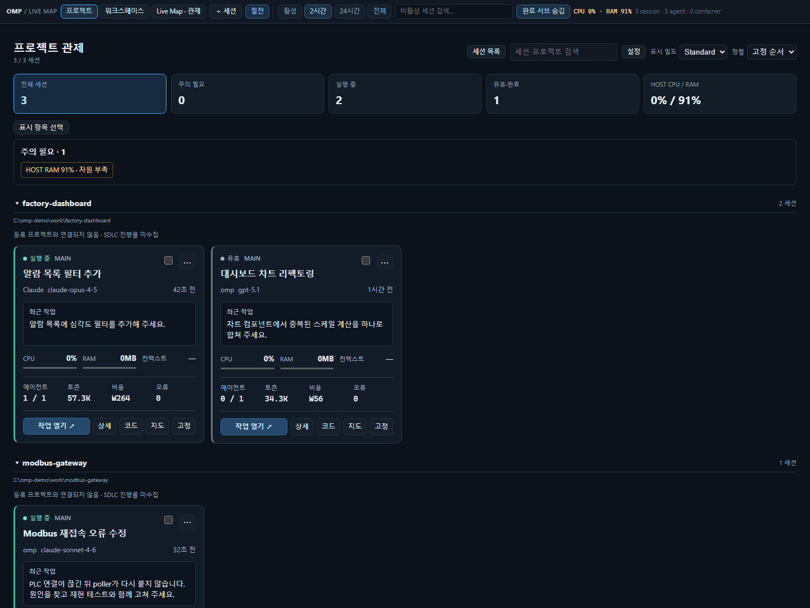
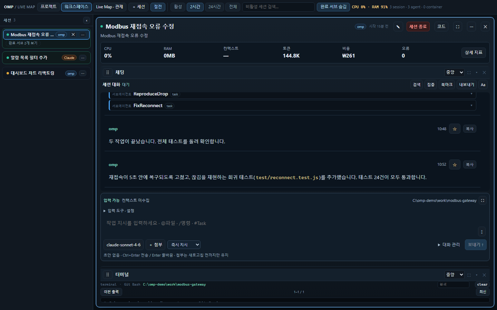
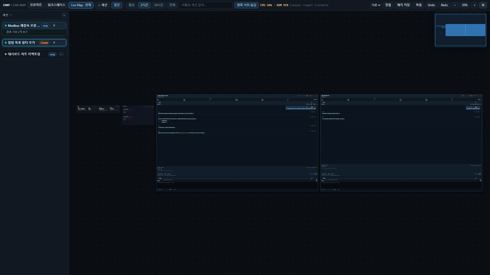

# 관제와 Live Map 사용법

세션 목록, 큰 카드, 블록(채팅·터미널·편집기·브라우저·DB), Live Map 조작을 설명합니다. 화면 구성은 [README의 주요 화면](../../README.md#주요-화면)에서 먼저 볼 수 있습니다.

## 세션 전체를 지도 한 장으로

왼쪽 세션 목록에 최근 활동한 세션이 한 묶음씩 나오고(main 한 줄, 그 아래 서브에이전트 들여쓴 줄), 지도에는 줄을 눌러 연 큰 카드만 올라옵니다. HOST 카드는 이 PC의 RAM·CPU·디스크·가동 시간을, WSL·Docker 카드는 배포판과 컨테이너 상태를 보여 줍니다. 위쪽 `활성`·`2시간`·`24시간`·`전체` 버튼으로 기간을 고르고, 휠로 확대·축소하고 빈 바탕을 끌어 이동합니다. 오른쪽 위 미니맵에 지금 보는 범위가 표시됩니다.

Compose 프로젝트 카드에서 `start`를 누르면 해당 프로젝트를 `docker compose up -d`로 실행합니다. WSL·Compose·컨테이너 동작 버튼은 요청과 상태 조회가 끝날 때까지 진행 상태를 표시하고 중복 실행을 막습니다. 실패하면 오류를 알립니다.

## 에이전트 카드

목록의 한 줄이 에이전트 하나입니다. 상태 점(진행 중·대기·끝남), 이름, 하네스 칩, 답 대기·주의 배지, 지금 돌고 있는 툴과 경과 시간이 한 줄에 보이고, 토큰·모델·컨텍스트는 줄 위에 마우스를 올리면(title) 나옵니다. 자세한 지표·스파크라인·프로세스 자원은 큰 카드에 있습니다. 끝난 서브에이전트는 목록에서 접혀 있고 `완료 서브 N개 보기`로 펼칩니다. 패널은 접을 수 있고 오른쪽 가장자리를 끌어 폭을 바꿉니다(접힘·폭은 저장).

## 카드를 열어 대화·지표 보기

목록 줄을 클릭하면 현재 화면 안 빈 자리에 큰 카드가 열립니다(이미 열려 있으면 그 카드로 화면이 이동). 메인 큰 카드를 열면 실행 중인 서브에이전트 큰 카드가 오른쪽에 자동으로 붙고, 끝나면 닫힙니다. 위쪽에는 누적 토큰 구성·비용·ttft·컨텍스트 구성(대화·툴 스키마·시스템)·세션 안 에이전트별 컨텍스트·툴 사용 횟수·프로세스 자원이, 아래쪽에는 블록이 놓입니다. 세션 카드의 기본 블록은 대화 기록(채팅), Git Bash 터미널, 세션 폴더의 파일 트리입니다.

대화 블록은 응답 생성이나 도구 작업이 진행 중일 때 입력창 위에 상태를 표시합니다. 터미널에서 시작한 세션은 실시간 활동 확장이 보낸 이벤트를 기준으로 표시합니다.

## 브라우저 블록

개발 서버 주소(`http://127.0.0.1:8080` 등)나 로컬 html 경로를 넣으면 카드 안 iframe으로 띄웁니다. 블록을 추가하면 카드가 1920×1080 크기로 맞춰집니다.

## 로컬 작업 카드: 터미널과 파일 트리

세션과 상관없는 작업 카드를 Ctrl+N이나 빈 바탕 우클릭으로 만듭니다. 터미널은 Git Bash로 명령을 실행하고(Shift+Enter는 백그라운드 잡), 편집기 블록의 탐색기가 카드 폴더를 펼쳐 보여 줍니다. 블록은 카드 우클릭 메뉴에서 더하고 뺍니다(편집기·터미널·백그라운드 잡·브라우저·DB 조회). 빈 바탕 우클릭의 **새 브라우저 카드**는 브라우저 블록 하나만 가진 로컬 카드(제목 `브라우저 N`)를 만듭니다.

카드 닫기(✕)는 화면만 닫고 세션은 유지합니다. 명시적인 `세션 종료` 및 `프로세스 정리만`은 별도 명령입니다. 프로세스 정리는 해당 카드에서 맵이 실행한 백그라운드 잡과 그 자식만 대상으로 합니다. 같은 폴더의 다른 터미널이나 세션은 폴더 경로만으로 종료하지 않습니다. 맵이 소유한 OMP 세션은 명시적인 세션 종료 요청에서 별도로 종료합니다.

## 화면과 조작

요소 계층은 사이드 목록 + 스테이지(맵) → 큰 카드 → 블록입니다. 맵의 클러스터는 HOST·WSL/Docker·로컬 작업 카드만 남았습니다.

- **세션 목록**: 세션마다 main 한 줄 + 서브 들여쓴 줄. 열린 항목은 강조되고, 검색으로 고정한 세션도 여기에 나옵니다.
- **클러스터**: WSL·Docker, HOST(RAM·CPU·디스크·가동 시간), 로컬 작업 카드. 세션 에이전트는 클러스터 테두리·작은 카드·미러 카드가 없습니다.
- **큰 카드**: 목록에서 열린 에이전트 하나. 위쪽(chrome)은 토큰·비용·ttft·컨텍스트·툴 사용·자원 지표, 아래쪽(body)은 블록입니다. 열린 세션의 백그라운드 잡 카드는 그 큰 카드 아래에 붙습니다.
- **블록**: `chat`(대화 기록, 프롬프트 전송·취소·요약), `terminal`(Git Bash), `bg`(백그라운드 잡 출력), `browser`(개발 서버 미리보기), `db`(SQLite·MySQL·MariaDB·Oracle 조회), `context`(지금 세션이 실어 나르는 컨텍스트 — 압축 요약·메시지·툴 결과를 순서대로, 항목별 토큰 수와 함께. 작업 가이드 전송·선택 항목을 뺀 압축). 카드 우클릭 메뉴에서 추가·제거하고, 블록마다 접기·순서 변경·높이 조절을 합니다.

| 조작 | 동작 |
|---|---|
| 세션 목록 줄 클릭 | 큰 카드 열기(열려 있으면 그 카드로 이동). 줄 오른쪽 ✕: 카드만 닫기(세션 유지) |
| 세션 목록 줄 우클릭 | 카드 메뉴 |
| 클러스터 제목 클릭 | HOST·인프라·로컬 클러스터 선택 (Shift+클릭: 다중 선택) |
| 로컬·인프라 작은 카드 더블클릭 | 큰 카드 열기. 큰 카드의 ✕: 닫기 |
| 클러스터 제목·로컬·인프라 카드 끌기 | 선택된 클러스터 이동 |
| 큰 카드 끌기 | 그 큰 카드(+붙은 서브 카드)만 이동 |
| Ctrl+Z / Ctrl+Shift+Z | 배치 Undo / Redo |
| Alt+1 / Alt+2 / Alt+3 | 관제 / 워크스페이스 / Live Map |
| Alt+N / Alt+F | 새 세션 / 활성 카드 집중 보기 |
| Shift+큰 카드 헤더 클릭 | 다중 선택 후 함께 이동 |
| Ctrl+휠 / 일반 휠 / `+` `-` `0` `1` | 지도 확대·축소 / 이동 / 키보드 확대·축소·전체 보기·100%. 카드 내부 일반 휠은 카드에서만 처리 |
| 빈 바탕 끌기, Space+끌기, 가운데 버튼 | 화면 이동 |
| 우클릭 | 카드 메뉴(블록, 세션 프로세스 종료, 숨기기, 고정) / 빈 바탕 메뉴 |
| Ctrl+N | 로컬 작업 카드 추가 |
| 터미널 Enter / Shift+Enter / ↑↓ | 실행 / 백그라운드 실행 / 명령 기록 |
| 채팅 Ctrl+Enter | 그 세션에 프롬프트 전송(`omp -p -r <세션 파일>`) |
| 채팅·새 세션 입력창 Ctrl+V / 파일 끌어 놓기 | 이미지·파일 첨부(입력창 아래 칩, ×로 빼기). 전송한 이미지는 대화 기록에도 표시합니다. 파일당 20MB, 합계 60MB, 10개까지. 넘으면 칩에 오류를 띄우고 보내지 않음 |
| 토큰 바 클릭 | 세션 누적 ↔ 최근 1시간 |
| 툴 칩 클릭 | 대화를 그 툴을 쓴 턴으로 거르기 |
| 세션 컨텍스트 행 클릭 | 그 에이전트 카드로 이동 |
| 이름 더블클릭 또는 ✎ | 카드 이름 바꾸기(비우면 원래 이름) |

배치·숨김·고정·이름·블록 구성은 브라우저 `localStorage`(`omp-map-*`)에 저장됩니다.

## 코드 편집기

main 세션·로컬 카드의 코드 편집기는 기본 블록이 아닙니다. 카드의 `코드` 버튼 또는 블록 메뉴에서 명시적으로 열 수 있습니다(서브에이전트 카드에는 없음). 대화(chat)가 있는 카드에서는 대화 오른쪽에 나란히 놓이고(경계를 끌어 폭 비율 조절, 카드별 저장), 대화가 없는 로컬 카드에서는 전체 폭입니다. 왼쪽 액티비티 바(탐색기 접기/펼치기)·탐색기 사이드바(세션 cwd 기준 파일 트리: 폴더 펼침/접힘·지연 로드·경로 필터·새로고침·상위 폴더, 폭 조절)·상단 탭(미저장 ●, ×, 미리보기 탭은 이탤릭)·브레드크럼·Monaco 본문·파란 상태바(문제 수·저장 상태·줄/열·언어·LSP)로 이루어집니다. 파일 클릭은 미리보기 탭, 더블클릭은 고정 탭이고, 탐색기 우클릭 메뉴는 **경로 복사(절대경로)**·**이름 복사**·**터미널 cwd를 이 폴더로**를 줍니다. 카드마다 Monaco·탭·미저장 내용을 따로 가지며 재렌더·카드 이동·크기 조절에도 유지되고 카드를 닫으면 정리됩니다. Monaco Editor 를 jsDelivr CDN 에서 파일을 처음 열 때만 받으므로 npm 의존성은 없고, 오프라인이면 열리지 않습니다. 옛 저장 블록 구성의 `files` 는 `editor` 로 합쳐집니다.

- `Ctrl+S`: 저장. 읽을 때 받은 `mtime` 과 현재가 다르면(다른 곳에서 수정) 409 로 알리고 덮어쓸지 묻습니다.
- `F12`·`Ctrl+클릭`: 정의로 이동. Python 은 `pyright-langserver --stdio`(PATH, 환경변수 `OMP_PYRIGHT`, 또는 `%LOCALAPPDATA%\Programs\Python\Python39\Scripts\pyright-langserver.exe` 순서로 찾음)를 파일의 프로젝트 루트마다 하나 띄워 씁니다. 다른 파일의 정의면 그 파일을 탭으로 열고 위치로 이동합니다. JS/TS 는 Monaco 내장 TypeScript 서비스로 같은 파일의 정의로 이동합니다.
- 진단: Python 은 입력이 멈춘 뒤 약 600ms 후 서버에 물어 빨간 밑줄을 긋고, JS/TS 문법 오류는 Monaco 가 스스로 표시합니다. 그 밖의 언어는 구문 강조만 합니다.
- Python 언어 서버가 없으면 편집·저장은 그대로 되고 상단에 `Python 언어 서버 없음` 이 표시됩니다. 언어 서버 프로세스는 5분 유휴 시 스스로 종료합니다.
